# 🛡️ 天R專屬登錄器逆向分析與自製登入架構實施手冊

> [!IMPORTANT]
> **知識定位與調研來源**：
> 本文深入剖析天R（Lineage Remastered / L1R）世代之各類登入器（Launcher / Connector / 接續機 / 啟動加載器）技術架構。
> 涵蓋：
> 1. **商業加殼登錄器黑盒逆向**：以現場樣本 `I:\RHD\xxtt\Login.exe`（8.67 MB，VMProtect 3.5 全虛擬化、DuiLib、`LocalService.ini`、`ServerData0`、`LinLogin.dll`、`eat.exe`）之靜態與動態記憶體 Dump 逆向報告（`I:\RHD\.re\REPORT_Login.md`）為基石。
> 2. **開源 Connector 注入管線**：參照 GitHub 開源生態 `WantedGaming/L1JR-RemasterConnector` 與 `iamtieqi/L1JR-RemasterConnector` 之標準 C#/.NET 啟動管線、環境變數透傳與 `Login.ini` 規格。
> 3. **自研原生現代化登入器**：基於 `I:\RHD\RHDLauncher-rs`（Rust 1.98+ / egui / Tokio），徹底消除商業黑盒與惡意程式碼，實作雙通道 TCP 中繼、Hosts 受控攔截、`0x140A7A8C4` 客戶端原生記憶體 Socket 重定向 Hook，以及徹底根除握手斷線之「KeyPacket 根因 C 消除」。

---

## 🗺️ 天R登錄器演進矩陣與跨世代架構對照

```mermaid
graph TD
    subgraph Gen1["第一代：官方 Beanfun / PlayNC 平台"]
        G1Web["Web AppCenter / 網頁登入器"] -->|OAuth Token / HTTPS| G1Client["Lin.bin (檢查註冊表 PlayNC / L1RMST_KOR)"]
        G1Client -->|遠端認證 AWS 3.37.249.199:80| G1Auth["GameGuard 更新與帳號驗證"]
    end

    subgraph Gen2["第二代：市售加殼登錄器 (如 xxtt Login.exe)"]
        G2VMP["VMProtect 3.5 虛擬化外殼"] --> G2UI["DuiLib + IE/MSHTML WebBrowser"]
        G2UI -->|讀取 LocalService.ini| G2Mem["記憶體解出 ServerData0 (512B Stride)"]
        G2Mem -->|HTTP 抓取 list.txt?t=| G2Update["更新 eat 補丁與 Launcher.bin"]
        G2Update -->|CreateProcess| G2Bin["bin64\\LogonX64.bin (= Lin.bin)"]
        G2Bin -->|遠端線程注入| G2DLL["LinLogin.dll (Initializedll, loadingdll)"]
        G2DLL -->|提權執行| G2Eat["eat.exe 1 1 global (反外掛封包過濾)"]
    end

    subgraph Gen3["第三代：開源 Connector (WantedGaming / iamtieqi)"]
        G3Launcher["C# WPF / WinForms Connector"] --> G3Ini["根目錄寫入 Login.ini"]
        G3Ini -->|CREATE_SUSPENDED| G3Client["Lin.bin (WorkingDir = ClientRoot)"]
        G3Client -->|環境變數注入| G3Env["L1_DLL_PASSWORD / L1_CLIENT_SIDE_KEY"]
        G3Env -->|DLL 順序注入| G3Inject["bb64.dll, bdcap64.dll, libcocos2d.dll"]
        G3Inject -->|具名管道 \\\\.\\pipe\\L1R_Launcher_Pipe| G3IPC["心跳同步與 Token 透傳"]
    end

    subgraph Gen4["第四代：自研 Rust 原生零黑盒 (RHDLauncher-rs)"]
        G4Core["RHDLauncher.exe (Rust 1.98+ / egui)"] --> G4Elevate["requireAdministrator 清單 + 自我提權"]
        G4Core --> G4Hosts["hosts 受控區段 (攔截 kaixingongyi.com 遠端覆寫)"]
        G4Core --> G4Relay["Tokio 異步 TCP Relay (2000, 29467 -> 3000)"]
        G4Core -.->|進階零中繼方案| G4Hook["0x140A7A8C4 SocketMain connect 原生改寫"]
        G4Relay --> G4Server["L1RHD 服務端 (處方 A: 停發 KeyPacket 杜絕錯位)"]
    end
```



### 跨世代登錄器技術特徵對比表

| 維度 | 第一代：官方平台 | 第二代：市售加殼登錄器 (`Login.exe`) | 第三代：開源 Connector | 第四代：自研 Rust 登錄器 (`RHDLauncher-rs`) |
| :--- | :--- | :--- | :--- | :--- |
| **開發語言 / 框架** | C++ / CEF / C# WebBrowser | C++ / DuiLib / IE(MSHTML) | C# .NET 8 / WPF 或 WinForms | **Rust 1.98+ / egui / Tokio** |
| **保護與反調試** | GameGuard / nProtect | **VMProtect 3.4/3.5 (CRT Provider)** | 無保護（開源開放） | **無黑盒加殼、純原生開源、零惡意代碼** |
| **反編譯可讀性** | 高（主體已脫殼為原生 x64） | 原始碼 **0%**（已虛擬化為 `.vmp1` Bytecode） | **100%** C# 源碼 | **100%** Rust 源碼 |
| **伺服器導向機制** | 官方 CDN 與 DNS | `LocalService.ini` 密文解密轉向 | 根目錄 `Login.ini` | **Hosts 阻斷 + TCP Relay / 記憶體 Hook** |
| **進程注入機制** | 官方內嵌模組 | `VirtualAllocEx` 注入 `LinLogin.dll` | 順序注入 `bb64.dll`、`bdcap64.dll` 等 | 支援原生調用、代理 Relay 或直接 Connect Hook |
| **外部相依性** | 依賴遊戲橘子/PlayNC 服務 | 依賴遠端清單站（若失效需斷網） | 依賴 .NET Runtime | **零外部依賴、免 Python、單一二進位執行檔** |
| **額外常駐進程** | GameGuard 驅動 | `eat.exe 1 1 global` (封包鉤子) | 具名管道後台常駐 | **無額外進程，中繼在程式內異步執行** |

---

## 🔍 二、市售加殼登錄器（`Login.exe`）逆向深入取證

現場樣本：`I:\RHD\xxtt\Login.exe`（檔案大小 8,679,936 Bytes，MD5: `3275D5610583ABC15D6D4C2847C942FA`）。

### 2.1 檔案與段表特徵
- **PE 機器架構**：AMD64 (x64) 原生 GUI 程式。
- **EntryPoint**：RVA `0xDB3853`，完全落在 `.vmp1` 區段內。
- **段表特異性**：
  - `.text`、`.rdata`、`.data`、`.pdata` 之 `RawSize` 全為 **0**，檔案磁區無數據，執行期由 VMProtect 解密動態映射。
  - `.vmp0`：虛擬配置區（VSize 0x6023F4，Raw 0）。
  - `.vmp1`：VMProtect 核心 Bytecode 與解譯器（VSize 0x83FD24，RawSize 0x83FE00，**資訊熵高達 7.955**）。
- **保護技術判定**：**VMProtect 3.4+/3.5 CRT Provider 模式**。字串表殘留 `InvokeMainViaCRT`、`ExitMainViaCRT`、`Microsoft.CRTProvider`。原始 C 邏輯已被編譯為自定義 Bytecode，靜態反組譯只能得到 VM 解譯器循環，逆向成本極高。

### 2.2 執行期記憶體 Dump 突破：取得解密後的原始 `.rdata`
在記憶體運行環境（PID 8236 於動態解密完成後），透過 Python/PE 記憶體轉儲工具成功在非模組可讀區捕獲原始資料段：
1. **位址 `0x7FF71923E000`（大小 268 KB）**：
   - 包含完整的 DuiLib RTTI 結構資訊：`.?AVCPaintManagerUI@DuiLib@@`、`.?AVCWebBrowserUI@DuiLib@@`、`.?AVCControlUI@DuiLib@@`。
   - 證實 UI 架構為 **DuiLib + GDI+ + zlib**，內嵌瀏覽器採用系統原生 **IE/MSHTML (`ieframe.dll`, `urlmon.dll`)**，並非客戶端內部使用的 CEF (Chromium)。
   - 提取出登錄器 UI 版面資源檔案：`main.xml`、`Skin\UIRoot.xml`、`animationWindow.zip`，以及按鈕控制項名稱：`label_caption`、`btn_start`、`btn_server1`~`btn_server8`、`btn_link1`~`btn_link6`。
2. **位址 `0x7FF719281000`（大小 28 KB）**：
   - 解出 `LocalService.ini` 中 `ServerData0` 加密欄位在記憶體中的真實展開結構！

### 2.3 `LocalService.ini` 與 `ServerData0` 512-Byte 記憶體對映規格
在 `LocalService.ini` 中：
```ini
[update]
ver=1001
url=http://www.google.com/update/launcher.exe
[list]
ServerData0=NfbLrritehTIDCTCQz8sGhL8fdAPAhRGn1xaVvcUPTa7SVeMxd5SkZ1h... (214 bytes Base64)
```
逆向分析證實：`ServerData0` 的密文解密後，在記憶體區段 `0x7FF719281000` 以 **512 位元組（0x200）固定間距**（Unicode UTF-16LE）存放各項設定欄位：

```
+0x000 ┌──────────────────────────────────────────────────────────────┐
       │ (保留/前綴狀態)                                               │
+0x1DA ├──────────────────────────────────────────────────────────────┤
       │ "单机登录器专用-购买商业版请联系QQ 252924326" (商業浮水印)   │
+0x25A ├──────────────────────────────────────────────────────────────┤
       │ "1001" (版本號 ver)                                          │
+0x27A ├──────────────────────────────────────────────────────────────┤
       │ "http://www.kaixingongyi.com/xinttdj/1.html" (公告首頁 URL)  │
+0x47A ├──────────────────────────────────────────────────────────────┤
       │ "http://www.kaixingongyi.com/xinttdj/list.txt" (伺服器清單來源)│
+0x67A ├──────────────────────────────────────────────────────────────┤
       │ "http://www.kaixingongyi.com/xinttdj/update" (更新補丁目錄)  │
+0x880 ├──────────────────────────────────────────────────────────────┤
       │ "星星天堂论坛" (按鈕 1 名稱)                                 │
+0x8A0 ├──────────────────────────────────────────────────────────────┤
       │ "星星天堂论坛" (按鈕 2 名稱)                                 │
+0x8C0 ├──────────────────────────────────────────────────────────────┤
       │ "加入QQ群"                                                   │
+0x8E0 ├──────────────────────────────────────────────────────────────┤
       │ "游戏充值"                                                   │
+0x900 ├──────────────────────────────────────────────────────────────┤
       │ "资料查询"                                                   │
+0xD20 ├──────────────────────────────────────────────────────────────┤
       │ "https://jq.qq.com/<redacted>" (QQ群跳轉)          │
+0xF20 ├──────────────────────────────────────────────────────────────┤
       │ "http://www.google.com/pay.php" (儲值網址)                   │
+0x1120├──────────────────────────────────────────────────────────────┤
       │ "https://www.lineagecoach.com/" (資料查詢網址)               │
       └──────────────────────────────────────────────────────────────┘
```

> [!NOTE]
> **重大逆向結論**：
> `ServerData0` 的明文結構與各欄位位移已完全透明。市售登錄器之所以需要聯網，是因為它每次啟動都會訪問 `kaixingongyi.com` 抓取遠端 `list.txt` 來動態覆蓋本機設定。若無法聯網（或被 Hosts 阻斷），登錄器便會退回使用本地的預設設定。

### 2.4 執行與注入生命週期序列
登錄器在按下「開始遊戲」（`btn_start`）後的完整呼叫鏈：
1. **檢查管理員權限**：清單標記 `requestedExecutionLevel="requireAdministrator"`，無權限時彈窗並重啟。
2. **抓取清單與更新吃檔**：
   - 透過 `sprintf("%s?t=%d", list_url, time())` 抓取 `list.txt`，寫入 `%TEMP%\slist_<timestamp>.txt`。
   - 解析更新清單中的 `files`、`file_N`、`md5_N`，逐一比對本地資源與下載補丁。
3. **建立客戶端進程**：
   - 調用 `CreateProcess("bin64\LogonX64.bin")`。
   - **實測關鍵點**：`bin64\LogonX64.bin` 與 `bin64\Lin.bin` 之 MD5 完全相同（`18328DB21B0A13C63F399AF80DC82A33`，18,989,568 Bytes）。它就是天R官方客戶端本體，只因啟動檔名不同而走不同分組邏輯。
4. **遠端執行緒注入登入模組**：
   - 藉由 `VirtualAllocEx` + `WriteProcessMemory` 寫入 `LinLogin.dll` 路徑。
   - 調用 `CreateRemoteThread(kernel32!LoadLibraryW)` 將 `LinLogin.dll` 注入到遊戲進程。
   - 呼叫 `LinLogin.dll` 匯出函式：`Initializedll`、`loadingdll`、`TestFunction`（`__stdcall`，無參數）。
5. **提權並拉起外掛防護組件**：
   - 登錄器自身啟用 `SeDebugPrivilege`。
   - 調用 `CreateProcess("eat.exe 1 1 global")` 啟動封包處理解析模組。
6. **自毀交接**：
   - 等待客戶端進入 `game Initialize Complete!` 狀態後，登錄器自身進程呼叫 `ExitProcess(0)` 退出。

---

## 🛠️ 三、開源 Connector 標準啟動注入管線規格

綜合 `WantedGaming/L1JR-RemasterConnector` 等開源實作，現代天R自製連線器標準管線具備以下不可違背的關鍵規則：

### 3.1 工作目錄規則（Working Directory Rule）
- **致命陷阱**：啟動 `Lin.bin` 時，`CreateProcessW` 的工作目錄（`lpCurrentDirectory`）**必須為遊戲根目錄**（例如 `I:\RHD\L1RHD`），絕不能設為 `bin64\`！
- **原因**：客戶端內部的 `lin.log`、`lineage.cfg`、`<角色名>.loc` 以及資源目錄 `data\`、`ui\` 皆基於根目錄相對路徑尋址，設錯會引發 0xC0000005 崩潰。

### 3.2 根目錄 `Login.ini` 規範
在啟動 `Lin.bin` 之前，登入器需於遊戲根目錄預先寫入 `Login.ini`：
```ini
[Server]
ip=127.0.0.1
port=2000

[Options]
RememberUser=1
Language=1
```

### 3.3 進程環境變數安全密鑰透傳
在調用 `CreateProcess` 時，將以下安全密鑰透過環境塊傳入：
```bash
L1_DLL_PASSWORD=2052201973
L1_CLIENT_SIDE_KEY=711666385
```

### 3.4 掛起啟動與 DLL 注入管線（Rust 實作）
在 `I:\RHD\RHDLauncher-rs\src\inject.rs` 中實現的完整代碼邏輯：

```rust
// 1. 以 CREATE_SUSPENDED 狀態建立客戶端進程
let mut cmd = Command::new(&exe_path);
cmd.current_dir(client_root);
cmd.env("L1_DLL_PASSWORD", "2052201973");
cmd.env("L1_CLIENT_SIDE_KEY", "711666385");
cmd.creation_flags(0x0000_0004); // CREATE_SUSPENDED

let child = cmd.spawn().map_err(|e| format!("啟動 Lin.bin 失敗: {e}"))?;
let pid = child.id();

// 2. 在目標進程分配空間並注入 libcocos2d.dll
let hproc = OpenProcess(PROCESS_ALL_ACCESS, false, pid)?;
let load_addr = GetProcAddress(GetModuleHandleW(w!("kernel32.dll"))?, s!("LoadLibraryW"))?;

for dll in &target_dlls {
    let dll_w = wide(&dll.to_string_lossy());
    let bytes = dll_w.len() * 2;
    let remote = VirtualAllocEx(hproc, None, bytes, MEM_COMMIT | MEM_RESERVE, PAGE_READWRITE);
    WriteProcessMemory(hproc, remote, dll_w.as_ptr() as *const c_void, bytes, None)?;
    
    let th = CreateRemoteThread(hproc, None, 0, Some(std::mem::transmute(load_addr)), Some(remote), 0, None)?;
    WaitForSingleObject(th, 8000);
    CloseHandle(th);
}

// 3. 恢復主執行緒
resume_process(pid);
```

---

## ⚡ 四、自研 Rust 登錄器（`RHDLauncher-rs`）核心架構

為徹底擺脫第二代商業登錄器的加殼綁架與遠端清單覆寫，`I:\RHD\RHDLauncher-rs` 實現了完全透明、免安裝 Python 的輕量級 Rust 原生登入器。

```
I:\RHD\RHDLauncher-rs\
├── Cargo.toml            # 依賴: eframe 0.37 (egui), tokio 1.54, windows 0.61
├── build.rs              # 內嵌 requireAdministrator 清單
├── assets\
│   └── NotoSansTC-Regular.otf  # 內嵌繁體中文字型 (避免 egui 豆腐字)
├── src\
│   ├── main.rs           # 提權檢查 -> 載入配置 -> 啟動 UI 迴圈
│   ├── elevate.rs        # IsUserAnAdmin 與 ShellExecuteW runas 自我重啟
│   ├── hosts.rs          # 寫入 hosts 受控區段 (封鎖 kaixingongyi.com)
│   ├── relay.rs          # Tokio 異步雙向 TCP Pump (2000/29467 -> 3000)
│   ├── cfgfile.rs        # lineage.cfg TLV 特徵搜尋與安全防護
│   ├── sockhook.rs       # 0x140A7A8C4 SocketMain connect 指令前綴驗證
│   ├── remotehook.rs     # 遠端行程 Inline Hook 跳板 Shellcode 構造
│   ├── inject.rs         # 掛起啟動、DLL 注入與執行緒恢復
│   └── ui\
│       ├── mod.rs        # egui 雙分頁版面 (伺服器選單 / 即時狀態監控)
│       └── theme.rs      # 深色暗黑主題樣式
```

### 4.1 核心模組一：Hosts 受控區段阻斷 (`hosts.rs`)
- **機制**：原版 `Login.exe` 會強制訪問 `http://www.kaixingongyi.com/xinttdj/list.txt` 來洗掉本地設定。
- **解法**：不採用激進的全局斷網，而是透過精確管理 `C:\Windows\System32\drivers\etc\hosts`：
  ```ini
  # >>> RHD Launcher managed >>>
  127.0.0.1 kaixingongyi.com
  127.0.0.1 www.kaixingongyi.com
  # <<< RHD Launcher managed <<<
  ```
- **安全保障**：寫入前自動產生 `hosts.rhd.bak`，關閉登入器時可一鍵還原並調用 `ipconfig /flushdns` 刷新緩存。

### 4.2 核心模組二：Tokio 異步 TCP Relay (`relay.rs`)
天R客戶端底層硬編碼連向 `127.0.0.1:2000` 或 `29467`，而本地服務端（`L1RHDserver`）監聽於 `3000` 端口。`relay.rs` 實現了高性能中繼：
1. **防止自我迴圈**：檢測若目標端口等於本機監聽端口，自動略過。
2. **強制接管衝突端口（`SO_REUSEADDR`）**：針對常見的 VMware NAT（`vmnat.exe`）佔用 2000 端口問題，以原生 WinSock 啟用端口重用機制強制綁定。
3. **雙棧監聽**：同時綁定 IPv4 `127.0.0.1` 與 IPv6 `::1`（預先設置 `IPV6_V6ONLY=1`，防止 IPv4 遭遮蔽）。
4. **雙向無損數據泵（Bidirectional Pump）**：
   ```rust
   let (mut ir, mut iw) = inbound.split();
   let (mut or_, mut ow) = outbound.split();
   let up = async { tokio::io::copy(&mut ir, &mut ow).await; ow.shutdown().await };
   let down = async { tokio::io::copy(&mut or_, &mut iw).await; iw.shutdown().await };
   tokio::select! {
       _ = stop_rx.changed() => {},
       _ = async { tokio::join!(up, down) } => {}
   }
   ```

### 4.3 核心模組三：原生記憶體 Socket 重定向 Hook (`sockhook.rs` & `remotehook.rs`)
在脫殼後的 `Lin.bin` 逆向中，已精確定位到客戶端網路連線呼叫點：
- **呼叫點位址**：`ImageBase + 0xA7A8C4`（函式 `SocketMain@Lineage`）。
- **呼叫慣例與原始彙編**：
  ```x86asm
  48 8D 54 24 20     lea  rdx, [rsp+0x20]    ; rdx 指向 16-byte sockaddr_in
  41 B8 10 00 00 00  mov  r8d, 0x10          ; namelen = 16
  FF 15 xx xx xx xx  call [ws2_32!connect]   ; 發起 TCP 連線
  ```
- **Shellcode 跳板改寫技術**：
  不改寫硬碟二進位檔，而是在客戶端進程掛起時配置 Trampoline 記憶體，動態修改 `rdx` 所指向的 `sockaddr_in`：
  ```x86asm
  ; 修改 sockaddr_in.sin_addr
  C7 42 04 <TargetIP>       mov dword ptr [rdx+4], <TargetIP>
  ; 修改 sockaddr_in.sin_port (Big-Endian)
  66 C7 42 02 <TargetPort>   mov word ptr [rdx+2], <TargetPort>
  ; 補回被覆蓋的原始指令
  48 8D 54 24 20            lea rdx, [rsp+0x20]
  ; 跳回原始代碼繼續執行
  E9 <Rel32>                jmp BackToOriginal
  ```
  此方案若啟用，客戶端將直接連向目標伺服器，**完全免除本機 TCP 中繼與 Hosts 修改**！

---

## 💥 五、關鍵疑難障礙與實戰解決方案（Troubleshooting）

### 5.1 GameGuard 錯誤代碼 380（Fail to connect the GameGuard update server）

> [!WARNING]
> **2026-10-24 19:00 實測修正**：本節原「方案 B」經完整實測**證實無效**，已下修等級為 `FAIL`。
> 可用方案只剩「方案 A」。

- **現象**：直接啟動 `bin64\Lin.bin` 或 `LogonX64.bin`，遊戲在數秒後閃退並彈出 GameGuard 380。

- **根因（實測補強）**：
  1. 客戶端內建 GameGuard 初始化：`InitNPGameMon`（字串見 `Lin_unpacked.exe` `0x5c701c8`）。
  2. 客戶端會嘗試連向下列端點，**全部已失效**：
     ```
     nprotect.ncsoft.co.kr        → DNS 解析失敗（網域已不存在）
     update.nprotect.net:80       → 可連但回非預期內容
     nprotect.co.kr:80            → 可連但回非預期內容
     nconfig.ini → 211.218.149.71:80 → 實測不通
     GameGuard\GameGuard.ver      → 停在 2017-09-25
     ```
  3. **GameGuard 不走 HTTP 判斷**：以 hosts 將全部 nprotect 網域導向 `127.0.0.1`，
     並在 80 埠啟動會記錄請求的 HTTP 服務 → **GameGuard 未發出任何請求**（零筆記錄）。
     故「攔截 HTTP」路線無效。
  4. 另一條線：客戶端會連 AWS `3.37.249.199:80` 做 BeanFun 帳號驗證
     （`0x140073FA0`，JSON `{"Account": "%s", "IPAddress": "%s"}`）。
     脫離登錄器啟動時 `Account` 為空字串（`lin.log` 可見）。

- **對策（實測分級）**：

  | 方案 | 內容 | 實測結果 |
  | :--- | :--- | :--- |
  | **A（唯一可行）** | 由 `RHDLauncher` 呼叫**原版 `Login.exe`**，由其完成 GameGuard 初始化與 `LinLogin.dll` 注入交接 | ✅ **PASS**（2026-10-24 19:43 實機進遊戲） |
  | B | 掛起注入 + `L1_DLL_PASSWORD`/`L1_CLIENT_SIDE_KEY` + `libcocos2d.dll` | ❌ **FAIL**（仍 380） |
  | C | 改名 `bin64\GameGuard` 目錄 | ❌ FAIL（380） |
  | D | hosts 導向 nprotect 到 127.0.0.1 + 假 HTTP | ❌ FAIL（無任何請求） |
  | E | 自製注入 `LinLogin.dll` + 呼叫 3 匯出 | ⚠️ PARTIAL（注入成功，但版本號仍 `...01`） |

- **方案 B 的實測細節（記錄失敗證據，避免重試）**：

  ```
  1. 寫入 Login.ini（[Server] ip=127.0.0.1 port=2000）
  2. CreateProcess(bin64\Lin.bin, CREATE_SUSPENDED, cwd=客戶端根目錄)
  3. env: L1_DLL_PASSWORD=2052201973, L1_CLIENT_SIDE_KEY=711666385
  4. 注入 libcocos2d.dll（本機無 bb64.dll / bdcap64.dll 可用於此路徑）
  5. ResumeThread
  → 結果：仍彈 GameGuard 380，客戶端退出
  ```

### 5.2 握手成功的瞬間斷線：KeyPacket 的「停發」與「轉發」之爭

> [!CAUTION]
> **2026-10-24 19:00 實測推翻**：原「處方 A（停發 KeyPacket）」經完整實測**證實不可行**，已下修等級為 `FAIL`。
> 正確做法是 **保留 KeyPacket 發送**。

> [!CAUTION] 2026-10-31 終局改寫（以 ADR-005 固化＋B4 實機為準）
> 本節「KeyPacket **必須保留**／`session.write(new KeyPacket())` 必須保留」的結論**已再次被推翻**，現行固化架構（使用者明示，ADR-005）為：
> - **伺服端永久停發 S_KEY**：`LineageProtocolHandler.java` 的 `session.write(new KeyPacket())` 已註解，閘門 `I:\RHD\checks\verify-keypacket-stopped.ps1` GateA（源碼）＋GateB（`gs.jar`）雙驗證，**任何代理人不得還原**。
> - **S_KEY 由客戶端側中繼補發**（`inject_s_key=true`，13 bytes 幀只寫往客戶端方向）：客戶端拿到 S_KEY 即恢復送包，但全域加密旗標維持 0、上下行全程明文 → 與 ADR-005「雙端明文」同時成立。B4 已兩次實機進世界（[[20261030-天R登入器B4中繼補發S_KEY與進入世界實證]]）。
> - 本節「必須保留」的**正確語意**只剩一層：「客戶端必須**收到** S_KEY 才會送包」——滿足它的責任方是**中繼**，不是伺服端。下方「正確做法」程式碼區塊保留為歷史記錄，**不得照做**。
> 另：本節下方「199 body 全密文」相關假設也已被改判（序號明文遞增、尾端結構化明文、5 變體解密全失敗），見 [[20261030-天R登入握手證據整合與阻塞點]] §3.2。

- **現象**：登入器中繼連線正常，客戶端也成功連入，但客戶端不送出任何資料或登入後斷線。

- **根因查核（三端交叉審查）**：

  1. **客戶端逆向**：收到 Opcode 15（S_KEY）後會將旗標 `0x145EAA9CC` 設為 1，
     自此啟用下行 RC4 + 上行 CBC 滾動加密 + 4-Byte 序號。
  2. **伺服端代碼**：`LineageProtocolHandler.sessionOpened()` 無條件發送 `new KeyPacket()`，
     但 `LineagePacketEncoder`/`LineagePacketDecoder` **全程明文**
     （`LineageEncryption.java` 經 grep 確認為死代碼，僅自身引用）。
  3. **表面推論（錯誤）**：既然雙端加密狀態不一致，只要不停發 KeyPacket 讓客戶端維持明文即可。

- **實測結果（推翻上述推論）**：

  | 做法 | 實測結果 |
  | :--- | :--- |
  | **停發 KeyPacket** | ❌ 客戶端連上 2000 後**零位元組上傳**；relay 記錄 `connected to server` 但無任何 `C>S` 資料；客戶端停在 `GetLastError(found==false)` |
  | **保留 KeyPacket** | ✅ 正常：`S>C 13 bytes` → `C>S 161 bytes` → `S>C 90 bytes` → 完整登入 |

  **關鍵事實**：客戶端是在**等待 S_KEY**，收不到就不繼續。
  停發不是「跳過加密」，而是「讓客戶端卡死」。

- **正確做法**：

  ```java
  // LineageProtocolHandler.java:25 —— 必須保留
  session.write(new KeyPacket());
  ```

  通訊之所以能通，是因為**實測顯示伺服器 Encoder 送出的明文與客戶端解密後結果一致**
  （客戶端 S-box 未經 KSA 前為全零，RC4 輸出等價明文，見 [[20261024-天R客戶端BIN反編譯與主體脫殼]] §10.21.1）。

- **停發的副作用（實測記錄）**：
  以腳本連 `127.0.0.1:3000` 三次，停發後確實不再收到 13 bytes ——
  但這只證明「伺服器行為改變」，**不代表客戶端可用**。

- **結論**：KeyPacket **必須保留**。真正的問題在伺服器端 DB 編碼（見 §5.4）。### 5.3 `lineage.cfg` 的 Tag 0x08 迷思
- **現象**：社群舊筆記常認為 `lineage.cfg` 中的 Tag 0x08 是伺服器連線 Port。
- **實測澄清**：
  - 09:20 啟動時 Tag 0x08 為 `11702`；09:32 啟動時漂移為 `55398`。
  - 客戶端在每次登入時皆會自動覆寫此檔案，且實際 TCP 連線永遠走 2000。
  - **結論**：Tag 0x08 僅為隨機 Session 記號或校驗戳記，並非連線 Port。登入器不需要也不應該強行修改 Tag 0x08。

---

### 5.4 登入後被踢：DB 角色名編碼與伺服器請求不一致（**真正根因**）

> [!IMPORTANT]
> 這是本案**最耗時**的排查點。所有 GameGuard、KeyPacket、注入問題都通了之後，
> 最後仍卡在「角色選單可以出現，但點入場就被踢」。

- **現象**：

  ```
  資訊: 空PC进入游戏被踢, 账号= 5566 请求角色名= 测试1
  ```

- **三端比對**：

  | 位置 | 值 | UTF-8 Hex |
  | :--- | :--- | :--- |
  | DB `characters.char_name`（修復前） | 測試1（**繁體**） | `E6B8AC E8A9A6 31` |
  | 伺服器收到的請求 | 测试1（**簡體**） | `E6B58B E8AF95 31` |
  | `L1PcInstance.load()` 查詢結果 | — | **NULL → `client.kick()`** |

- **編碼鏈（三端契約）**：

  ```
  客戶端 → 伺服器：BIG5 解碼 + ZHConverter.convert(s, 1)  // 繁轉簡
  伺服器 → 客戶端：ZHConverter.convert(s, 0) + BIG5 編碼   // 簡轉繁
  ```

- **`ZHConverter` 方向實證（JDK 8 實測）**：

  ```
  SIMPLIFIED  = 1
  TRADITIONAL = 0

  convert(測試1 [E6B8ACE8A9A631], 1) → E6B58BE8AF9531   ← 繁體變簡體
  convert(測試1 [E6B8ACE8A9A631], 0) → E6B8ACE8A9A631   ← 不變
  ```

  → 證明 `readS()` 的 `convert(s, 1)` **確實是繁轉簡，方向正確**。
  → 因此 **DB 必須存簡體**（符合 `run.bat` 註解「ALL internal data is Simplified」）。

- **修復**：

  ```sql
  -- 1. 先備份
  CREATE TABLE characters_backup_20261024 AS SELECT * FROM characters;

  -- 2. 繁體 → 簡體
  UPDATE characters SET char_name='测试1' WHERE HEX(char_name)='E6B8ACE8A9A631';

  -- 3. 驗證
  SELECT char_name, HEX(char_name) FROM characters;
  -- 测试1  E6B58BE8AF9531
  ```

- **狀態**：✅ `PASS`（2026-10-24 19:28 實機進入遊戲世界，角色 17 級）

---

### 5.5 `character_buff` 主鍵衝突導致狀態保存失敗（TR-BUG-61）

- **現象（伺服器日誌）**：

  ```
  十月 24, 2026 7:40:35 下午 com.lineage.server.datatables.CharBuffTable StoreBuff
  資訊: 状态保存错误 状态ID==1001 角色ID==536871476
  意外角色退出1
  ```

- **根因**：`character_buff` 主鍵為 `(char_obj_id, skill_id)` **聯合主鍵**，
  但 `CharBuffTable.StoreBuff()` 使用 `INSERT INTO`：

  ```java
  pstm = con.prepareStatement("INSERT INTO character_buff SET char_obj_id=?, skill_id=?, ...");
  ```

  同一角色重複保存同一種 buff 時直接觸發主鍵衝突。手動驗證：

  ```
  ERROR 1062 (23000): Duplicate entry '536871476-1001' for key 'PRIMARY'
  ```

- **影響**：登出／斷線時技能狀態無法保存；偶發「意外角色退出1」。

- **修復**：

  | 項目 | 修改前 | 修改後 |
  | :--- | :--- | :--- |
  | `StoreBuff` | `INSERT INTO` | **`REPLACE INTO`** |
  | `SaveBuff` | 直接逐筆存 | **先 `deleteBuff(pc.getId())` 清舊資料** |

  ```java
  // 1. REPLACE INTO（解決重複主鍵）
  pstm = con.prepareStatement("REPLACE INTO character_buff SET char_obj_id=?, skill_id=?, remaining_time=?, poly_id=?");

  // 2. SaveBuff 開頭先清舊資料
  public static void SaveBuff(final L1PcInstance pc) {
      deleteBuff(pc.getId());
      // ... 原邏輯
  }

  // 3. 新增 deleteBuff
  private static void deleteBuff(final int objId) {
      con = L1DatabaseFactory.getInstance().getConnection();
      pstm = con.prepareStatement("DELETE FROM character_buff WHERE char_obj_id=?");
      pstm.setInt(1, objId);
      pstm.execute();
  }
  ```

- **備份**：`CharBuffTable.java.codex-backup-20261024-BUFF-DUP.bak`

- **狀態**：✅ `PASS`（JDK 8 編譯通過、jar 熱替換、實機登入無錯誤）

---

### 5.6 本機中繼（Relay）的 Socket timeout 陷阱

- **現象**：客戶端連上中繼後約 **5 秒**必定斷線，日誌出現 `timed out`。

- **根因**：Python 版中繼使用 `socket.create_connection(TARGET, timeout=5)`，
  該 timeout **會持續作用於後續所有 recv/send**，不是只影響連線階段。

- **修復**：

  ```python
  server_sock = socket.create_connection(TARGET, timeout=5)
  server_sock.settimeout(None)   # ← 關鍵：清除 timeout
  ```

- **Rust 版**：`tokio::net::TcpStream::connect` 無此問題，
  但 `pump()` 需確保兩個方向獨立轉發、任一方向 EOF 不強制中斷另一方向。

---

### 5.7 `Login.exe` 的父進程檢查機制（實測）

比對歷史成功紀錄（2025-07-17，原作者環境）與我方執行：

| 階段 | 成功版 | 直接啟動 |
| :--- | :--- | :--- |
| `Found CurrentFileName` | ✅ | ✅ |
| `GetLastError(filename) 31` | ✅ | ❌ **缺失** |
| `parentFile LogonX64.bin(14540)` | ✅ | ❌ **缺失** |
| `GetLastError(found==false) : 18` | ✅ | ✅ |
| `StateManager Change UI State` | ✅ | ❌ **卡住** |

**成功版關鍵**：父進程本身也是 `LogonX64.bin`（14540 → 17016），
代表客戶端會**自己再啟動一個自己**，子進程檢查父進程通過才繼續。

**我方嘗試**：以自製 `Login.exe`（LoginHost）作為父進程 → **無效**，
客戶端不認名稱，只認 `Login.exe` 的完整初始化時序（版本號 `...05` 為指標）。

---

## 📋 六、登入器發行與驗收檢核清單（DoD）

自研登錄器（`RHDLauncher.exe`）發布前必測檢驗項目：

- [x] **管理員權限自我保護**：在非管理員終端執行時，自動調用 UAC 提升權限，無報錯退出。
- [x] **單檔綠色發行**：在未安裝 Python 及 .NET Runtime 的純淨 Windows 10/11 x64 系統上，僅需 `RHDLauncher.exe` + `servers.ini` 即可運行。
- [x] **中文介面顯示正常**：內嵌 `NotoSansTC-Regular.otf`，在任何語系 Windows 上介面皆無豆腐字或亂碼。
- [x] **Hosts 攔截與還原**：啟動時成功將 `kaixingongyi.com` 指向 `127.0.0.1`，關閉或點擊「解除封鎖」時原原本本還原原始 `hosts`。
- [x] **中繼衝突接管**：本機若有 VMware NAT 佔用 2000 端口，中繼器能透過 `SO_REUSEADDR` 成功接管並輸出警告日誌。
- [x] **遊戲啟動與連線閉環**：點擊「直接開始遊戲」後，客戶端正常彈出，連入本地中繼，伺服器日誌顯示成功進入登入世界，全程無崩潰閃退。

---

## 🌐 七、開源生態全景調研與 GitHub 現有開源登錄器對照

在社群與 GitHub 開源網路上，天R（L1R / Lineage Remastered）專用登錄器呈現「商業閉源二開把持，但開源社群已確立標準管線」的格局。主要開源專案及其架構分析如下：

### 7.1 開源專案一：`baboqoo/L1J-Wanted`（天R私服開源代表作）
- **專案位址**：`https://github.com/baboqoo/L1J-Wanted`（L1J-Remastered 衍生版）
- **語言與架構**：C# .NET + 專屬 Hook DLL + Web AppCenter。
- **核心工程哲學（引自其 `wiki.md`）**：
  1. **客戶端二進位檔絕對保持原始未改（Unmodified `Lin.bin`）**：
     NCSoft 頻繁更新客戶端之 Opcode 與封包防作弊機制，任何直接靜態修改 `Lin.bin` 的行為都會隨小版本升級而崩潰。因此開源標準是「`Lin.bin` 保持 100% 官方原始原裝」。
  2. **Connector 扮演中介橋樑（Intermediate Component）**：
     由 Connector 以掛起狀態拉起客戶端，將客製化 DLL（`libcocos2d.dll`、`boxer.dll`）加載至遊戲記憶體中。
  3. **記憶體通訊攔截與 IP 重定向（Communication Interception & IP Redirection）**：
     由注入的 DLL 在記憶體中攔截 `Lin.bin` 發出的 TCP 連線請求，將目標 IP 改寫為私服/模擬器 IP，實現免中繼、免改 HOSTS 的直連。
  4. **全參數運行結構（Operating Parameters Structure）**：
     DLL 運行需要一組完整的資料結構（即我們在 `start.exe` 逆向中破解的 `FxPipeProtocol` 17 個 Opcode 數據流）。
  5. **整合工具鏈**：內建自動差異補丁下載、PAK 內容比對解包、自動配置 Windows Defender 目錄排除規則等。

### 7.2 開源專案二：`r0ptik/L1J-3.8-launcher`（現代 Rust 登入器標竿）
- **專案位址**：`https://github.com/r0ptik/L1J-3.8-launcher`
- **技術價值**：
  - **純 Rust + WebView2**：單一二進位執行檔、零 .NET / Python 運行庫依賴、跨 Windows 版本相容。
  - **雙階段注入技術（Two-Stage Injection）**：以原生 Win32 API 實施乾淨的 DLL 注入與記憶體跳板改寫，免除傳統商業登錄器綁定驅動或全局鉤子帶來的報毒問題。
  - **架構借鏡**：本專案的 `RHDLauncher-rs`（Rust 1.98+ / egui / Tokio）即全面吸納了該專案的單檔無毒設計理念。

### 7.3 韓系開源鼻祖：`RemastedConnector`（`MJSoftConnectEX` / 本機 `start.exe`）
- **地位**：天R私服 Connector 的源頭（韓國開發者 MJSoft 開創）。
- **關鍵貢獻**：
  - 開發了全套官方命令列全參數模板（`/AuthnToken`, `/SessKey`, `/PresenceId:L1_KOR` 等 9 大參數），徹底破除官方防作弊之「6 秒自殺（GameGuard 380）」。
  - 建立了 `\\.\pipe\MJSoftConnectEX` 命名管道雙向控制協議，以動態注入方式下發四大關鍵 Opcode（`C_LOGOUT 0xE9`、`C_LOGIN 0xB0`、`C_CHANNEL 0xEB`、`S_CUSTOM_MESSAGE_BOX 0xB4`）。

---

## ⚖️ 八、商業加殼閉源（`Login.exe` / `eat.exe`）vs 開源方案之深度對比與去毒化指南

在目前的私服環境中，許多架設者依賴前人包裝好的 `Login.exe`。本手冊透過逆向取證，揭開商業加殼閉源版之實況與潛在危害：

### 8.1 過去開服「必須拔網路線 / 斷網」的真正原因
- **商業加殼黑盒之弊端**：
  市售加殼登錄器（如 `Login.exe`，星星天堂／開心公益）在啟動時，其更新執行緒會強制向作者的伺服器發送 HTTP 請求：
  ```text
  GET http://www.kaixingongyi.com/xinttdj/list.txt?t=<unixtime>
  ```
  - 若能聯網：登錄器會將下載回來的遠端清單**直接覆蓋本地的 `LocalService.ini`**，導致伺服器列表被作者強行綁架，開服者只能連向作者的商業伺服器。
  - 若聯網失敗：登錄器拋出 `读取伺服器列表文件失敗`，退回使用本地 `LocalService.ini`。
  - **歷史妥協**：因此過去私服玩家只能透過「拔網路線」、「停用網路介面卡」或「斷網」來逼迫登錄器使用本地伺服器清單！
- **開源去毒解法**：
  `RHDLauncher-rs` 透過在系統 `hosts` 建立專屬受控區段：
  ```ini
  # >>> RHD Launcher managed >>>
  127.0.0.1 kaixingongyi.com
  127.0.0.1 www.kaixingongyi.com
  # <<< RHD Launcher managed <<<
  ```
  讓登錄器在有網環境下自動連向本機而失敗退回，**徹底終結「拔網路線開服」的歷史鬧劇**。

### 8.2 伴隨進程威脅：`eat.exe 1 1 global` 的真面目
- **取證發現**：
  商業登錄器在啟動遊戲後，會以管理者權限執行 `eat.exe 1 1 global`。逆向表明 `eat.exe`（MFC 程式）會調用 `SetWindowsHookExW` 安裝 `eat.dll` 的全域 Windows 鍵盤與訊息鉤子（`global` 參數）。
- **安全風險**：
  該全域鉤子會攔截全系統之按鍵與訊息，極易被防毒軟體（Windows Defender、卡巴斯基）直接判定為 Trojan/Keylogger 惡意軟體，且若被作者利用可能帶來遠端下發惡意二進位檔的巨大隱患。
- **開源替代方案**：
  完全捨棄 `eat.exe` 與 `eat.dll`。由開源登入器透過本地 Tokio TCP 中繼、或在 `Lin.bin` 內部進行微型記憶體跳板 Hook，達成無毒、純淨、零後門的連線導航。

---

## 🚀 九、徹底淘汰第三方閉源登錄器的自製遷移實施指南

針對想要從「依賴第三方閉源登錄器」過渡到「完全自主可控開源登入」的團隊，提供兩條漸進式實施路線：

### 9.1 路線 A：平穩過渡託管模式（已在 `RHDLauncher.exe` 實證通過）
適合希望保留當前相容性、但消除斷網與手動操作痛點的場景：
1. **外殼置換**：使用者僅雙擊純 Rust 撰寫的 [`RHDLauncher.exe`](file:///I:/RHD/RHDLauncher-rs/RHDLauncher.exe)。
2. **自動 Hosts 阻斷**：登入器啟動時自動寫入 Hosts 阻斷 `kaixingongyi.com`，退出時自動還原並刷新 DNS。
3. **異步 TCP Relay 轉向**：登入器在背景自動綁定 `127.0.0.1:2000` 與 `29467`（若遇 VMware NAT 衝突自動以 `SO_REUSEADDR` 接管），將流量轉向服務端的 `3000` 端口。
4. **靜默拉起交接**：Rust 登入器調用 `CreateProcess` 靜默啟動 `Login.exe`，由原版完成客戶端加載，隨後原版登錄器在 6 秒內自行退出。
5. **握手相容**：服務端套用處方 A 停發 KeyPacket，進入全明文安全通訊。

### 9.2 路線 B：終極原生開源模式（純 `Lin.bin` 直啟，完全無黑盒）
適合徹底剔除 `Login.exe` 與 `eat.exe` 的純淨架構：
1. **官方命令列全參數模板直啟**：
   登入器直接調用 `CreateProcessW` 啟動 `bin64\Lin.bin`，工作目錄必須設為**遊戲根目錄**，並傳入解密之全參數：
   ```cmd
   bin64\Lin.bin /AuthnToken:"token123" /SessKey:"sess123" /ServiceRegion:"NCS" /AuthProviderCode:"np" /ServiceNetwork:"Live" /NPServerAddr:"https://api.ncsoft.com:443" /UidHash:"798363913" /PresenceId:"L1_KOR:3C164CEB-D15F-E011-9A06-E61F135E992F" /UserAge:10
   ```
2. **根目錄放置標準 `Login.ini`**：
   ```ini
   [Server]
   ip=127.0.0.1
   port=2000
   [Options]
   RememberUser=1
   Language=1
   ```
3. **注入環境變數與支援庫**：
   - 進程環境塊寫入：`L1_DLL_PASSWORD=2052201973`、`L1_CLIENT_SIDE_KEY=711666385`。
   - 掛起狀態以 `CreateRemoteThread(LoadLibraryW)` 注入 `libcocos2d.dll`（或 `gamepresence.dll`）。
4. **記憶體 Connect Hook 直連**：
   在 `ImageBase + 0xA7A8C4`（`SocketMain@Lineage`）安裝 5-byte Trampoline JMP，直接將 `rdx` 指向之 `sockaddr_in` 改寫為自建伺服器位址，達成零中繼直連！

---

## 🔗 十、相關文獻與關聯筆記

- [[20261024-天RMJSoftConnectEX原始啟動管線與命名管道協議白皮書]]：MJSoftConnectEX 命名管道 17 大 Opcode、官方全參數模板與 C# 反組譯白皮書。
- [[20261024-天R-自製登入器RHDLauncher企畫書]]：Rust 登錄器模組化詳細設計與 UI 規範。
- [[20261024-天R開源Connector技術深度解析-啟動注入管線與PAK雙層加密破譯]]：開源 Connector 完整管線與 PAK 雙層 XOR 演算法。
- [[20261024-天R客戶端BIN反編譯與主體脫殼]]：`Lin.bin` 脫殼、`0x140A7A8C4` Connect 呼叫點與加解密協議。
- [[20261024-天R握手金鑰根因C修復與登入器進度]]：KeyPacket 停發處方 A 與 Mina 通訊實證。
- [[20261024-天R客戶端門禁三防體系與Connector-API實裝白皮書]]：天R客戶端反外掛與伺服端門禁體系。
- [[00-總覽與索引/20261024-天堂跨世代全系統三端架構交叉審查總表]]：全世代跨版本三端對照總表。

---

## 🔬 十一、執行期深度採證：LinLogin.dll 補丁套裝與版本號機制完全破解（2026-10-24 深夜，證據等級 PASS）

> [!TIP]
> **本章已擴寫為專題筆記 [[20261025-天R登入器執行期採證與LinLogin六刀補丁破解]]**（含管線除錯史、六刀完整反組譯、Shared 解碼表、2020 minidump 旁證與路線 B 修訂版處方）——細節以該筆記為準，本節保留摘要。

> 補充章節：三份二進位（Login.exe / LinLogin.dll / Lin.bin）**全部加殼**（VMProtect ×2 ＋ SecureEngine 系自訂殼 ×1），靜態全死；
> 透過「RHDLauncher 託管 ＋ 代點開始遊戲 ＋ 分塊容錯 ReadProcessMemory」管線取得執行期解密映像。
> 完整工程細節與腳本教訓見 `I:\RHD\.re\REPORT_Login.md` §11；傾印產物在 `I:\RHD\.re\cap\out
un3\`。

### 11.1 核心結論

1. **`lin.log` 為 XOR 0x4D 混淆**，可解；路線 A 成功實錄 client version `2002122605`。
2. **版本號 01→05 的改寫者是 LinLogin.dll**：其解密代碼內同時含 `2002122601`（防護檢查 cmp+jne）與 `2002122605`（補丁值），
   以絕對位址 `mov [client+0x5CBB800], 2002122605` 與 `mov [client+0x5CBB808], 2002122605` 直寫客戶端版本對。
3. **完整補丁套裝 = 6 個固定 RVA**（版本對×2、2-byte NOP@0xE658B1、5-byte JMP detour@0x97FC8C、RET 閹割@0x97D020、4-byte 值@0x9E4CA8）——這就是「客戶端只認 Login.exe 時序」的機械實體，方案 E 當年缺的就是這六刀。
4. **Shared 區段（RVA 0x474000, 512B）是 Login.exe ↔ LinLogin.dll 的配置通道**：執行期含啟用旗標、連線指紋、
   `127.0.0.1`、埠 `2000`、標籤「本机测试」。客戶端連向 127.0.0.1:2000 的源頭在此（與 TCP Relay 設計互補）。
5. `LogonX64.bin` 由 Login.exe **無參數啟動**（命令列實測為空）——官方命令列全參數模板並非必要路徑。

### 11.2 自製登入器最小等價處方（路線 B 修訂版，待實機驗證）

`CREATE_SUSPENDED` 啟動 `bin64\LogonX64.bin`（cwd=根目錄）→ 對客戶端寫入 §11.1-3 六個 RVA 補丁 → Resume。
5-byte JMP 的第 5 byte 需執行期讀原值計算。若 380 復發，再比對 GameGuard 目錄狀態差異。
