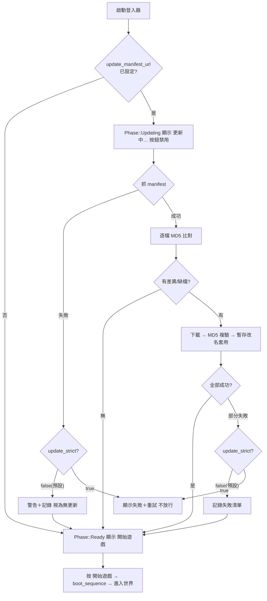

# L1RHD 自動更新企畫書

> **狀態**：APPROVED-PENDING-IMPL（決策已定，待施工）
> **決策者**：使用者（2026-10-31 拍板四項，見 §1）
> **對象**：`G:\L1RHD`（天R 客戶端）、`G:\L1RHD\RHDLauncher-B4-skkey.exe`（B4+，吃檔引擎已內建）
> **前置調研**：[[20261031-381登入器自動更新企劃蒐證與可行性評估]]（JJ-000024/25 教學、815 清單協議、L1J-Wanted、歐霸天堂 NCTinyUpdater 四源蒐證）
> **本文性質**：實作規格書。後續 AI 只讀本篇即可施工，不必重跑調研。

---

## 0. 一頁摘要

在 B4+ 已上線的 manifest 吃檔引擎（`updater.rs`，commit `dd2e3ad`）之上，做三件事：

1. **更新空間＝靜態 HTTP**（私服自架；manifest 與資源同目錄樹）。
2. **下載的資源落在客戶端絕對路徑**（執行期由 `game_dir` 解析的絕對路徑下；manifest 內一律相對路徑，不寫死）。
3. **啟動閘門**：登入器啟動即自動執行「抓 manifest → 比對 → 下載 → 吃檔」；**此期間「開始遊戲」不可按**；吃檔結束（成功或失敗）才顯示「開始遊戲」，按下才進入遊戲世界。

吃檔粒度本階段＝**鬆散檔**（`data\*.tbl/xml/json` 等，與歐霸天堂官方 `Login.local` 契約同構）；**PAK 層封裝不在本企畫範圍**（另案）。

---

## 1. 決策記錄（2026-10-31 使用者拍板）

| # | 決策 | 內容 | 否決的替代方案 |
|---|---|---|---|
| D1 | 更新空間＝**靜態 HTTP** | 私服自架靜態檔案服務，manifest＋資源同樹 | GitHub 公開倉庫（紅線：客戶端資源不入庫＋100 MB 上限）；GitHub 私有（token 分發風險）；FTP（多一層服務） |
| D2 | 資源落**客戶端絕對路徑** | manifest 相對路徑 → `<game_dir 絕對路徑>\<相對路徑>`；絕對路徑執行期解析，不寫死原始碼（符合 [[L1RHD 當前路徑規範]]） | 相對 cwd（工作目錄易漂移） |
| D3 | 下載後**自動執行吃檔** | 下載完成即就地套用（暫存改名＋MD5 複驗），不需人工 | 手動按鈕吃檔 |
| D4 | **啟動閘門** | 更新／吃檔期間不可啟動遊戲；結束後顯示「開始遊戲」才可進入世界 | 現行「按進入遊戲才背景吃檔、失敗可續玩」（改為啟動即更新＋閘門） |

---

## 2. 已具備基礎（不必重做）

| 能力 | 現況 | 位置 |
|---|---|---|
| manifest 解析/比對/下載/驗證/套用 | `updater.rs` 引擎＋7 測試（含本地 HTTP 端到端） | `src/updater.rs`（commit `dd2e3ad`） |
| 資源落絕對路徑 | `safe_join(game_dir, rel)` 已按 game_dir 解析 | 同上 |
| 埠拓撲/補發 S_KEY/明文登入代理 | B4+ 現役 | `src/relay.rs` |
| 設定欄位 | `update_manifest_url`（空＝停用）、`update_strict` | `src/config.rs` |
| 伺服端 | 靜態檔案服務即可（任何 HTTP server） | 運維配置 |

**現行掛點與目標的差異**：現行吃檔掛在 `boot_sequence`（按「進入遊戲」後、`launch_inproc` 前的背景執行緒）；本企畫改為**啟動器啟動即執行**，並加 UI 閘門（§4）。

---

## 3. 目標流程

### 3.1 維護者端（每次發布資源）

```text
改資源（data\*.tbl/xml/json 鬆散檔）
  → 生成 manifest：[data\xxx] + md5=<hex>（Login.local 同格式；工具鏈見 §7）
  → 上傳到靜態 HTTP 根目錄：
       /patch/manifest.local          ← 清單
       /patch/data/xxx                ← 資源（與 manifest 相對路徑同構）
```

### 3.2 玩家端（每次啟動登入器）



---

## 4. UI 狀態機與啟動閘門規格（核心改動）

### 4.1 Phase 擴充

```rust
enum Phase { Idle, Updating, Ready, Booting, Failed }
```

| Phase | 按鈕 | 狀態列 |
|---|---|---|
| `Updating` | **禁用**（顯示「更新中…」） | `吃檔：檢查 N 條，已下載 M…`（進度事件驅動） |
| `Ready` | **啟用**（顯示「開始遊戲」） | `吃檔完成：檢查 N、更新 M、失敗 K`（K>0 附警告色） |
| `Failed`（strict 失敗） | 禁用＋「重試更新」按鈕 | 失敗原因 |

### 4.2 閘門硬規則

1. **閘門只在「有更新流程在跑」時生效**：`update_manifest_url` 留空 → 啟動後直接 `Ready`（現行行為不變）。
2. `Updating` 期間：`boot_sequence` 不可觸發（按鈕禁用即足夠，另加 phase 檢查雙保險）。
3. **吃檔結束（成功/失敗皆算）→ 進入 `Ready`**；`update_strict=true` 時僅「manifest 抓取失敗」與「有檔案套用失敗」兩種情況不進 `Ready` 而進 `Failed`（資源不齊保護）。
4. `update_strict=false`（預設）：任何失敗都記錄後放行（私服不在線不鎖死玩家）。
5. 啟動器重開即重跑一次更新流程（無本地 version 快取；逐檔 MD5 即時比對已涵蓋版本語意）。

### 4.3 進度回報

`run_manifest_update` 新增進度事件（mpsc/channel 或 callback）：每完成一檔推送 `(path, kind, bytes)`；UI 以 `ctx.request_repaint()` 節流刷新（egui 模式沿用 relay 日誌通道的做法）。

---

## 5. 模組改動清單（施工時照此動）

| 檔案 | 改動 | 規模 |
|---|---|---|
| `src/updater.rs` | `run_manifest_update` 加進度回報參數（`Box<dyn Fn(UpdateEvent) + Send>` 或 channel sender）；其餘邏輯不動 | 小 |
| `src/ui/mod.rs` | Phase 加 `Updating`；啟動即跑更新（搬到 UI 初始化後的背景執行緒，**從 `boot_sequence` 移除**）；按鈕 gate 與進度顯示；重試路徑 | 中 |
| `src/main.rs` | 無（更新由 ui 驅動） | — |
| `src/config.rs` | 無新欄位（`update_strict` 語意重定義為 §4.2-3/4，文件同步） | 文件 |
| `README.md`／SOP | 閘門行為與「開始遊戲」文案同步 | 文件 |

**不動的**：relay/inproc/hosts/launch 邏輯、manifest 格式、MD5 安全設計（防穿越、512 MiB/4 GiB 上限）。

---

## 6. 資料契約

### 6.1 manifest（`Login.local` 同格式，已實作）

```text
[data\string-c.tbl]
md5=d88dbbddf8ca46cb5180035d574ed151
[data\SpellList.xml]
md5=85bf4ea4b61d9b996a9e9b4562056271
```

- 路徑一律**相對客戶端根**、`\` 分隔；`md5` 小寫 hex 32 字元。
- 上限 5000 條；單檔 512 MiB；整輪 4 GiB。

### 6.2 絕對路徑解析規則（D2）

```text
最終落點 = <game_dir 絕對路徑>\<manifest 相對路徑>
game_dir 來源 = servers.ini 該服 profile 的 game_dir
  （留空/相對/死路徑 → normalize_game_dir() 退回登入器所在目錄，已有實作）
```

- 原始碼**不寫死**任何磁碟絕對路徑（路徑規範紅線）；絕對性只在執行期由 game_dir 保證。
- 防穿越：拒 `..`／磁碟號／開頭斜線（`safe_join` 已實作，測試覆蓋）。

### 6.3 伺服端目錄結構（靜態 HTTP）

```text
<HTTP root>/
└── patch/
    ├── manifest.local
    └── data/
        ├── string-c.tbl
        └── …（與 manifest 相對路徑同構，\ → / ）
```

任何靜態檔案服務可用（IIS/nginx/`python -m http.server`）；建置機生成 manifest 的工具鏈＝`LineageAIResourceToolkit`（tbl/pak 抽出）＋MD5 腳本（正式化腳本列 Stage 3）。

---

## 7. 失敗與邊界

| 情境 | 行為 | 依據 |
|---|---|---|
| HTTP 伺服器不在線／manifest 404 | strict=false：警告＋放行（視為無更新）；strict=true：Failed＋重試 | §4.2-3/4 |
| 個別檔案下載失敗/MD5 不符 | 該檔不套用（暫存丟棄），計入 `failed`；strict=false 放行 | 現行引擎行為 |
| 本地缺檔且下載失敗 | 同上（failed 列表會標「新增」） | 現行引擎 |
| 套用中斷（斷電/強殺） | 僅殘留 `*.rhd-dl-tmp` 暫存（下次啟動重跑即覆蓋）；Stage 1 加啟動清掃 `*.rhd-dl-tmp` | 新增小項 |
| Defender/CFA | 現白名單已放行；若搬機器需重配（事件 1123 為證） | [[l1rhd-b4-freeze-forensics]] |
| 雙開登入器/更新中啟動遊戲 | 閘門禁用＋phase 雙保險；既有 client_process_running 檢查不變 | §4.2-2 |

## 8. 範圍外（另案）

- **PAK 層吃檔**（圖檔/sprite/dialogue 封進 PAK）：工具包 `pak add/replace` 自動化＋交易紀律，或借鑑 L1J-Wanted 比對解包。
- version 單號機制（逐檔 MD5 已涵蓋語意）。
- 斷點續傳／增量差分（RFC3229/delta）。
- 815/Atu-381 客戶端適配（各有自己的清單協議）。

## 9. 實作階段與驗收

| Stage | 內容 | 驗收 |
|---|---|---|
| 1 | updater 進度事件＋暫存清掃；UI Phase::Updating＋閘門＋按鈕文案 | cargo test 全綠＋本地 HTTP 端到端（模擬慢伺服器觀察 Updating→Ready 轉換） |
| 2 | 伺服端落地：`X:\L1RHD\…`（或內網主機）起靜態 HTTP＋首批 manifest（zone3.xml 等已補檔項目） | 實機：改一個 tbl → 啟動登入器 → Updating → 開始遊戲 → 進世界後核對檔案 MD5 |
| 3 | manifest 生成腳本正式化（DataAll 權威來源→MD5 清單，接 B4 筆記 §8-3）＋運維 SOP（上傳帳號分離照 JJ 原則） | 維護者照 SOP 一鍵發布 |

**全域驗收**：① `update_manifest_url` 留空時行為與現版完全相同；② 有更新時按鈕全程禁用直到吃檔結束；③ 斷線/失敗不卡死（strict=false）；④ 全程日誌可回溯（`吃檔：`/`吃檔完成：` 行）。

## 10. 關聯

- [[20261031-381登入器自動更新企劃蒐證與可行性評估]]（四源蒐證與決策依據）
- [[20261031-天R登入器B4當機採證與歐霸天堂Login.exe反編譯取證]] §2.4/2.5（官方架構 RE＋引擎現況）
- [[20261030-天R登入器成功登入流程固化SOP]]（啟動流程與故障對照）
- [[20261024-天R-自製登入器RHDLauncher企畫書]]（主企畫；本篇為其自動更新子企畫）
- JJ_INDEX.md `launcher`/`patch`（JJ-000023/24/25 教學源）

## 11. 變更記錄

| 日期 | 變更 |
| :--- | :--- |
| 2026-10-31 | 初版。記錄使用者四項決策（靜態 HTTP／資源落客戶端絕對路徑／自動吃檔／吃檔結束前不可啟動遊戲）；定義 Phase::Updating 閘門、進度回報、失敗矩陣與三階段施工計畫。未施工。 |
