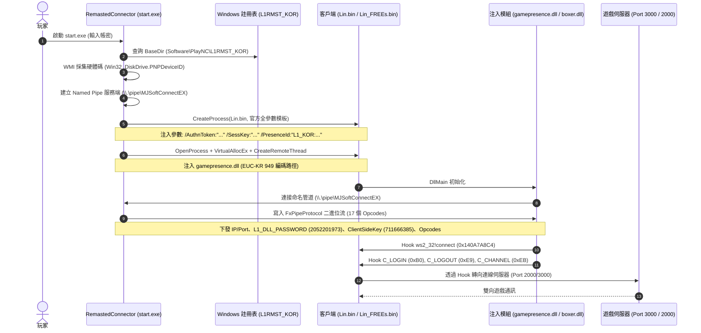

# 📡 天R MJSoftConnectEX 原始啟動管線、命名管道協議與官方參數白皮書

> [!IMPORTANT]
> **重大逆向突破與產物溯源**：
> 本文基於對現場二進位檔案 `I:\RHD\L1RHD\start.exe`（2,386,944 Bytes，.NET v4.0.30319）的真實中繼資料（Metadata）、IL Bytecode 與字串池逐位元組反組譯分析。
> 揭開了天R（Lineage Remastered）私服界流傳的 Connector 原生祖先——**韓國 MJSoft 所開發之 `RemastedConnector`（管道標識：`MJSoftConnectEX`）** 的完整內部架構：
> 1. 揭密 NCSoft 官方啟動 `Lin.bin` 的**真實命令列全參數模板**（`/AuthnToken`, `/SessKey`, `/PresenceId` 等 9 大參數）。
> 2. 徹底解密連接器與注入 DLL（`gamepresence.dll` / `boxer.dll`）之間的**命名管道（Named Pipe）二進位通訊協議與 17 個控制 Opcode**。
> 3. 還原官方註冊表路徑（`PlayNC\L1RMST_KOR`）、WMI 硬體碼採集（`PNPDeviceID`）以及客戶端四大關鍵核心 Opcode（`C_LOGOUT 0xE9`、`C_LOGIN 0xB0`、`C_CHANNEL 0xEB`、`S_CUSTOM_MESSAGE_BOX 0xB4`）的動態注入機制。

---

## 🗺️ 天R MJSoftConnectEX 啟動與 IPC 互動全景拓撲



---

## 🔑 一、NCSoft 官方客戶端啟動全參數模板解密

在分析 `RemastedConnector.Connect.GameStart.pipeconstart2` 時，捕獲到啟動天R客戶端 `Lin.bin` 所需的**完整官方命令列參數結構**：

```text
/AuthnToken:"{0}" /SessKey:"{1}" /ServiceRegion:"NCS" /AuthProviderCode:"np" /ServiceNetwork:"Live" /NPServerAddr:"https://api.ncsoft.com:443" /UidHash:"798363913" /PresenceId:"L1_KOR:3C164CEB-D15F-E011-9A06-E61F135E992F" /UserAge:10
```

### 參數語意規格矩陣

| 參數名 | 範例 / 預設值 | 語意與底層作用 |
| :--- | :--- | :--- |
| `/AuthnToken` | `m_auth_token` | 由連接器生成的隨機/固定 32 位元驗證令牌，繞過客戶端首屏空白自殺。 |
| `/SessKey` | `key2` | 會話金鑰，客戶端與授權伺服器握手憑據。 |
| `/ServiceRegion` | `"NCS"` | NCSoft 服務區域代碼（NCS 代表 NCSoft Korea/Global）。 |
| `/AuthProviderCode` | `"np"` | 認證提供商代碼（np 代表 nProtect / PlayNC 原生平台）。 |
| `/ServiceNetwork` | `"Live"` | 營運網路環境標識（可選 `Live` 或 `Test`）。 |
| `/NPServerAddr` | `"https://api.ncsoft.com:443"` | 官方認證 API 端點（客戶端以此校驗帳號狀態）。 |
| `/UidHash` | `"798363913"` | 玩家 UID 雜湊（固定長度數值），客戶端內部儲存為 AccountId。 |
| `/PresenceId` | `"L1_KOR:3C164CEB-D15F-E011-9A06-E61F135E992F"` | 遊戲識別碼（`L1_KOR` + 官方 GUID），代表韓國《天堂 Remastered》。 |
| `/UserAge` | `10` | 玩家年齡分級代碼（`10` 代表成年無防沉迷限制）。 |

> [!NOTE]
> **破除 6 秒自殺之謎**：
> 過去直接執行 `Lin.bin` 導致客戶端 6 秒自殺（GameGuard 380），正是因為客戶端啟動時若未檢測到上述參數（特別是 `/AuthnToken` 與 `/PresenceId`），客戶端會認為是非法獨立叫用而強制調用 `ExitProcess`。

---

## 📡 二、命名管道（Named Pipe）IPC 協議規格

在 `RemastedConnector` 架構中，連接器與遊戲客戶端注入模組（DLL）透過 Windows 具名管道進行進程間通訊（IPC）：
- **管道名稱**：`\\.\pipe\MJSoftConnectEX`
- **編碼格式**：位元組流（Binary Stream，由 `FxPipeStreamWriter` 封裝，長度前綴或緊密排列）。

### 2.1 管道控制 Opcode 列舉表 (`RemastedConnector.Connect.Opcodes`)

| 序號 | Opcode 常數名 | 十六進位 | 十進位 | 承載資料格式 | 語意說明 |
| :---: | :--- | :---: | :---: | :--- | :--- |
| 1 | `OP_GAMESERVER_ADDRESS` | `0x00` | 0 | String (Pascal) | 遊戲伺服器真實 IP（如 `127.0.0.1`） |
| 2 | `OP_GAMESERVER_PORT` | `0x01` | 1 | Int32 | 遊戲伺服器連線端口（如 `2000` / `3000`） |
| 3 | `OP_USE_APPCENTER` | `0x02` | 2 | Boolean | 是否啟用遊戲內 Web AppCenter 商城 |
| 4 | `OP_APPCENTER_ADDRESS` | `0x03` | 3 | String | Web AppCenter 伺服器 IP |
| 5 | `OP_APPCENTER_PORT` | `0x04` | 4 | Int32 | Web AppCenter 伺服器端口 |
| 6 | `OP_USE_SECONDS_PASSWORD` | `0x05` | 5 | Boolean | 是否啟用角色二級安全密碼 |
| 7 | `OP_LINBIN_NAME` | `0x06` | 6 | String | 客戶端執行檔名稱（`Lin_FREEs.bin` 或 `Lin.bin`） |
| 8 | `OP_C_LOGOUT` | `0x07` | 7 | Byte | 客戶端登出 Opcode（實測下發 **`0xE9` / 233**） |
| 9 | `OP_C_LOGIN` | `0x08` | 8 | Byte | 客戶端登入 Opcode（實測下發 **`0xB0` / 176**） |
| 10 | `OP_C_CHANNEL` | `0x09` | 9 | Byte | 分流切換 Opcode（實測下發 **`0xEB` / 235**） |
| 11 | `OP_S_CUSTOM_MESSAGE_BOX` | `0x0A` | 10 | Byte | 彈窗訊息 Opcode（實測下發 **`0xB4` / 180**） |
| 12 | `OP_LINBIN_VERSION` | `0x0B` | 11 | Int32 | 客戶端版本校驗碼 |
| 13 | `OP_CLIENT_SIDE_KEY` | `0x0C` | 12 | Int32 | 客戶端通訊校驗密鑰（**`711666385`**） |
| 14 | `OP_S_KEY` | `0x0D` | 13 | Byte | 服務端金鑰封包 Opcode（Opcode 15） |
| 15 | `OP_S_EXTENDED_PROTO_BUF` | `0x0E` | 14 | Byte | 下行 Protobuf 容器碼 |
| 16 | `OP_C_EXTENDED_PROTO_BUF` | `0x0F` | 15 | Byte | 上行 Protobuf 容器碼 |
| 17 | `OP_DLL_PASSWORD` | `0x10` | 16 | Int32 | DLL 通訊授權密碼（**`2052201973`**） |
| 18 | `OP_END_STREAM` | `0x64` | 100 | None | 協議封包結束標記 |

### 2.2 四大關鍵 Opcode 的動態注入價值
天R在不同客戶端子版本間，封包 Opcode 會發生漂移。`MJSoftConnectEX` 透過在遊戲啟動的瞬間，經由命名管道將服務端當前使用的 Opcode 動態餵入 `gamepresence.dll`，使注入的 Hook 程式碼能精確攔截：
- `C_LOGIN`（`0xB0`）：攔截玩家輸入的帳號密碼，實施代答或替換。
- `C_LOGOUT`（`0xE9`）：攔截登出請求，執行乾淨資源釋放。
- `C_CHANNEL`（`0xEB`）：伺服器分流跳轉。
- `S_CUSTOM_MESSAGE_BOX`（`0xB4`）：由連接器自定義彈出遊戲內通知視窗。

---

## 💉 三、DLL 注入管線與記憶體 Hook 機制

### 3.1 `FxDllInjector.do_inject` 實作還原
在 `RemastedConnector.Helper.FxDllInjector` 中，注入模組採用標準 Win32 API 鏈：
1. `OpenProcess(0x2000000 /* PROCESS_ALL_ACCESS */, false, pid)`
2. `GetProcAddress(GetModuleHandle("kernel32.dll"), "LoadLibraryA")`
3. 以 **EUC-KR（代碼頁 949，`0x3B5`）** 將 DLL 路徑轉換為 ANSI 位元組陣列。
4. `VirtualAllocEx(hProcess, NULL, 4096, MEM_COMMIT, PAGE_READWRITE)`
5. `WriteProcessMemory(hProcess, remoteMem, dllBytes, dllBytes.Length, NULL)`
6. `CreateRemoteThread(hProcess, NULL, 0, LoadLibraryA, remoteMem, 0, NULL)`
7. `WaitForSingleObject(hThread, INFINITE)` 並關閉句柄。

### 3.2 注入模組身分與分工
根據 `ConnectInfo..cctor` 之預設欄位值：
- `linbinfilename` = `"Lin_FREEs.bin"`（去殼或重命名之主程式）
- `msdllfilename` = `"gamepresence.dll"`（核心通訊與管道鉤子模組）
- `boxdllfilename` = `"boxer.dll"`（反調試與多開防護模組）
- `loaderfilename` = `"RemastedLoader.bin"`（前置引導載入器）

---

## 💻 四、硬體採集與註冊表探測機制

### 4.1 硬體特徵碼（HWID）採集
在 `Form1.get_hdd` 中，連接器執行 WMI 查詢：
```sql
SELECT PNPDeviceID FROM Win32_DiskDrive
```
提取硬碟隨插即用裝置識別碼（`PNPDeviceID`），經過雜湊處理後填入 `ConnectInfo.m_hdd_id`，隨後於登入封包或 REST API 傳送給服務端，實施多開限制與封鎖機器碼。

### 4.2 官方註冊表安裝路徑探測
在 `Form1.ForderLoad` 中，連接器依序探測以下 4 組註冊表鍵值：
```text
1. HKEY_LOCAL_MACHINE\Software\PlayNC\L1RMST_KOR
2. HKEY_LOCAL_MACHINE\Software\Wow6432Node\PlayNC\L1RMST_KOR
3. HKEY_LOCAL_MACHINE\Software\PlayNC\NCLauncherW
4. HKEY_LOCAL_MACHINE\Software\Wow6432Node\PlayNC\NCLauncherW
```
讀取字串值 `BaseDir`，獲取天R官方客戶端的實際安裝目錄，並驗證 `bin32\` 與 `bin64\` 是否具備完整的 NC 啟動器組件（缺少時提示：「在製作窗口中可能會出現Ting Kim現象，請安裝NC啟動器」）。

---

## 🏛️ 五、天R登錄器完整家族譜系

| 登錄器類型 | 典型檔案 / 專案 | 核心技術特徵 | 適用場景 |
| :--- | :--- | :--- | :--- |
| **官方原裝登入器** | PlayNC Web Launcher | OAuth Token、HTTPS、GameGuard NT64 | 官方正式營運環境 |
| **韓系原生開源** | **`start.exe` (MJSoftConnectEX)** | **.NET C#、命名管道 IPC、全參數模板啟動、`gamepresence.dll` 注入** | **天R開源私服之源頭標準** |
| **開源衍生版** | `WantedGaming / iamtieqi` | .NET 8 重構、WPF UI、雙層 PAK 解密工具 | 歐美與社群自研私服 |
| **市售商業加殼版** | `Login.exe` (星星天堂等) | VMProtect 3.5 虛擬化、DuiLib、`LocalService.ini`、`eat.exe` | 商業收費私服（具遠端控制） |
| **自研現代零黑盒** | **`RHDLauncher-rs` (Rust)** | **純 Rust、Tokio TCP Relay、Hosts 攔截、原生 Socket Hook、免 Python** | **完全自主可控、無毒無黑盒之終極方案** |

---

## 🔗 六、關聯知識庫筆記

- [[20261024-天R專屬登錄器逆向分析與自製登入架構實施手冊]]：市售加殼登錄器（Login.exe）與自研 Rust 登錄器架構全景。
- [[20261024-天R開源Connector技術深度解析-啟動注入管線與PAK雙層加密破譯]]：開源 Connector 啟動管線與 PAK 雙層 XOR 演算法。
- [[20261024-天R客戶端門禁三防體系與Connector-API實裝白皮書]]：GameGuard、`210916.asi`、`boxer.dll` 三防體系。
- [[20261024-天R雙通道認證協定與Connector伺服端網路架構全景手冊]]：Web Netty 與 Game TCP 雙通道鑑權。
- [[20261024-天R客戶端BIN反編譯與主體脫殼]]：客戶端脫殼、`0x140A7A8C4` Socket 重定向與 .proto 協定。
- [[00-總覽與索引/20261024-天堂跨世代全系統三端架構交叉審查總表]]：全世代跨版本三端對照總表。
