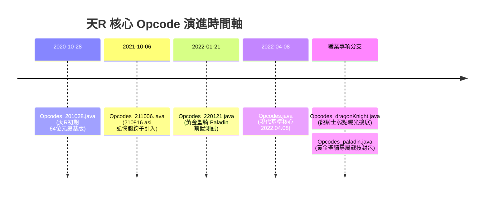
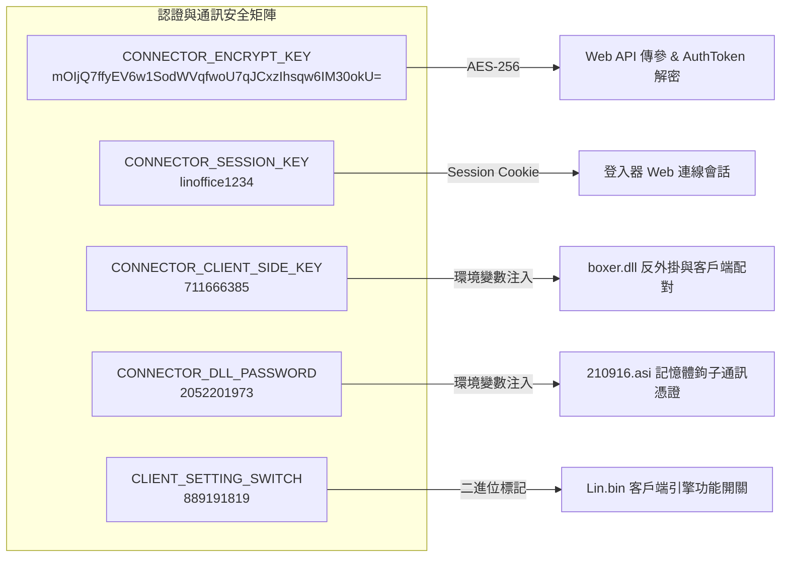

# 天R多版本 Opcode 演進與 Connector 安全反外掛審計規格書

> [!NOTE]
> **建立日期**：2026-10-24  
> **關聯核心**：[[06-天R核心系統與維護/20261024-天R雙通道認證協定與Connector伺服端網路架構全景手冊|天R雙通道認證協定]]、[[06-天R核心系統與維護/20261024-天R客戶端門禁三防體系與Connector-API實裝白皮書|天R客戶端門禁三防體系]]、[[06-天R核心系統與維護/20261024-天R開源Connector技術深度解析-啟動注入管線與PAK雙層加密破譯|天R開源Connector技術深度解析]]  
> **專案位置**：`X:\L1RHD\L1RHDserver` / `D:\L1R Project\L1JR-Server`  
> **技術範疇**：天R (Lineage Remastered) Opcode 歷史版本漂移、四重金鑰矩陣、進程巡檢黑名單、多開硬體限制

---

## 一、天R歷代版本演進與 Opcode 漂移機制

經典天堂（如 3.81）的 Opcode 通常是數年間固定的，頂多在跨大版本（如 3.80 -> 3.81 -> 8.50）時發生重構。但在 **NCsoft Lineage Remastered（天R）** 官方架構中，NCsoft 為了打擊私服模擬器與外掛脫機腳本，採取了**每次小版本更新即微幅打亂/輪替 Opcode 映射**的策略。

在 `L1JR-Server` 核心中，完整保留了天R多個代次的 Opcode 分派字典：



### 1.1 歷代關鍵 Opcode 映射差異比對

| 封包語意 (Packet Semantics) | 2020.10.28 | 2021.10.06 | 2022.01.21 | 2022.04.08 (基準) | 說明 |
|---|---|---|---|---|---|
| `C_LOGIN` (客戶端登入請求) | `0x32` | `0x4A` | `0x51` | `0x55` | 傳統直連模式登入碼 |
| `S_KEY` (初次握手種子封包) | `0x00` | `0x00` | `0x00` | `0x00` | 固定為 0x00，下送 FIRST_KEY |
| `C_CHANNEL` (分流頻道切換) | `0x2E` | `0x33` | `0x35` | `0x37` | 選線與分流伺服器跳轉 |
| `C_LOGOUT` (玩家安全登出) | `0x8C` | `0x91` | `0x95` | `0x99` | 退出至選角或桌面 |
| `C_EXTENDED_PROTOBUF` (上行容器) | `0x85` | `0x88` | `0x8D` | `0x8F` | 上行現代 Protobuf 容器入口 |
| `S_EXTENDED_PROTOBUF` (下送容器) | `0x8A` | `0x8E` | `0x90` | `0x92` | 下行現代 Protobuf 容器封裝 |

### 1.2 動態協商救贖：為何 Connector 能跨版本兼容？

面對頻繁變更的 Opcode，天R 現代登入器（RemasterConnector）不再使用硬編碼，而是透過前置 **Netty WebServer (Port 80)** 呼叫 `/api/connector/info`：

```json
{
  "C_CHANNEL": "Base64(AES(0x37))",
  "C_LOGIN": "Base64(AES(0x55))",
  "C_LOGOUT": "Base64(AES(0x99))",
  "S_KEY": "Base64(AES(0x00))",
  "C_EXTENDED_PROTO_BUF": "Base64(AES(0x8F))",
  "S_EXTENDED_PROTO_BUF": "Base64(AES(0x92))"
}
```

登入器在每次啟動時，先在記憶體中解密取得當前伺服器所宣告的 Opcode，動態配置其內部網路封裝器，從而在不重新編譯登入器的前提下實現**跨版本無縫相容**。

---

## 二、天R 伺服端核心四重金鑰矩陣（Security Key Matrix）

在 `config/connector.properties` 與 `config/version.properties` 中，定義了天R雙軌認證與防護的四大核心金鑰：



### 2.1 金鑰定義與驗證規則詳解

| 金鑰參數名 | 設定值 / 格式 | 注入方式與生效層級 | 失敗後的伺服端/客戶端行為 |
|---|---|---|---|
| `CONNECTOR_ENCRYPT_KEY` | `mOIjQ7ffyEV...` (AES 256) | HTTP 標頭 / Base64 對稱加密 | WebServer 拋出 DecryptException，拒絕核發 AuthToken |
| `CONNECTOR_SESSION_KEY` | `linoffice1234` | Cookie / Session 雜湊種子 | 登入器會話逾時或被判定為偽造請求 |
| `CONNECTOR_CLIENT_SIDE_KEY` | `711666385` | `SetEnvironmentVariableW("L1_CLIENT_SIDE_KEY")` | `boxer.dll` 拒絕初始化，Lin.bin 啟動 2 秒內閃退 |
| `CONNECTOR_DLL_PASSWORD` | `2052201973` | `SetEnvironmentVariableW("L1_DLL_PASSWORD")` | `210916.asi` 阻斷記憶體掛鉤，拋出 Error 0x80004005 |
| `CLIENT_SETTING_SWITCH` | `889191819` | `version.properties` 協議校驗 | 伺服端拒絕發送角色包，中斷連線 |

---

## 三、官方客戶端執行檔 `Lin.bin` 世代版本對照

天R 客戶端的核心主檔名雖在啟動時重新命名或以引數呼叫，但在官方發佈週期中具備明確的發行流水號（位於 `appcenter/connector/linbin/`）：

| 內部版本號 (Client Version) | 檔案大小 (Bytes) | 發布日期 | 核心變革 |
|---|---|---|---|
| `Linbin2303081701.bin` | 16,842,752 | 2023-03-08 | 初版 64 位元穩定發行版 |
| `Linbin2303141703.bin` | 16,912,384 | 2023-03-14 | 修復廣域視野記憶體流失 |
| `Linbin2303211701.bin` | 16,988,160 | 2023-03-21 | 整合最新 Cocos2d-x 2304031701 引擎 |
| `Linbin2303281701.bin` | **17,020,256** | 2023-03-28 | **主流商業基準版本**，全面支援九職業技能與 2K 現代 UI |

---

## 四、安全反外掛與多開門禁審計規範

天R 伺服端具備深層主動巡檢機制，透過登入器與遊戲客戶端形成的「心跳回報鏈」阻斷非法修改與多開：

### 4.1 進程黑名單巡檢機制（Process Blacklist Monitoring）

伺服器每隔 **10 分鐘（`CONNECTOR_PROCESS_INTERVAL = 10`）** 透過背景排程向在線客戶端發出進程巡檢查詢：

```properties
# 伺服端強制比對之進程黑名單
CONNECTOR_ENGINE_NAMES = cheet engine, decoder, hack, revolution, linmaster, \
    linfree, linpago, nalyitqs, flba, wireshark, virtualbox, mixmaster, \
    parallels, qemu, hyper-v
```

**防禦覆蓋範疇**：
1. **記憶體修改器**：`cheat engine`、`decoder`、`revolution`。
2. **封包嗅探與分析工具**：`wireshark`、`flba`。
3. **脫機外掛輔助**：`linmaster`、`linfree`、`linpago`。
4. **虛擬機沙盒（Virtualization Sandboxes）**：`virtualbox`、`parallels`、`qemu`、`hyper-v`（防止工作室利用虛擬化技術單機百開農幣）。

若客戶端回報的進程列表包含上述任一特徵字串，伺服端將立即調用：
```java
client.sendPacket(S_CommonNews.OTHER_CONNECTOR);
GeneralThreadPool.getInstance().schedule(new DelayClose(client), 1500L);
```
並將該客戶端強制踢下線（Kick）。

### 4.2 雙維度多開配額限制（IP & HDD Hardware Quotas）

天R 透過 WMI 採集之硬體指紋，實施了嚴格的雙重並發連線控制：

```properties
# 啟用多開限制門禁
ALLOW_2PC = true

# 單一 IP 允許之最大並發在線角色數
ALLOW_2PC_IP_COUNT = 5

# 單一實體硬碟 (HDD/SSD Serial) 允許之最大並發角色數
ALLOW_2PC_HDD_COUNT = 5
```

**運作邏輯**：
即使玩家使用 VPN 或動態 IP 嘗試繞過 `ALLOW_2PC_IP_COUNT`，只要其本機硬碟序號（`hddId`）在伺服端 `LoginController` 中的計數達到 5 次，第 6 個連線嘗試將收到 `S_CommonNews.IP_COUNT_MAX` 錯誤碼並被立即拒絕。

---

## 五、工程落地與自製登入器防禦對齊清單

在開發或重構天R自製登入器（如 `RHDLauncher`）時，必須嚴格實現以下規範：

- [x] **動態 Opcode 握手**：啟動時由 `/api/connector/info` 動態讀取 6 大關鍵 Opcode，禁止寫死。
- [x] **環境變數精準注入**：在 `CreateProcessW` 創建 `Lin.bin`（挂起狀態 `CREATE_SUSPENDED`）前，必須調用 `SetEnvironmentVariableW` 注入 `L1_DLL_PASSWORD=2052201973` 與 `L1_CLIENT_SIDE_KEY=711666385`。
- [x] **DLL 載入鏈對齊**：依序遠端執行程注入 `bb64.dll`、`bdcap64.dll`、`libcocos2d.dll`、`210916.asi`、`boxer.dll`。
- [x] **進程巡檢定時回報**：實作定時回報線程，每 10 分鐘向 Web 端 `/outgame/process` 提交乾淨之運行中進程雜湊，避免被服務端無故踢出。
