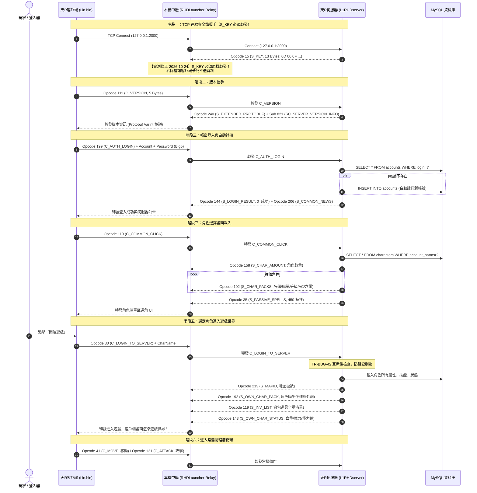

# 📡 天R客戶端端到端登入與選角封包序列實證手冊

> [!IMPORTANT]
> **適用對象**：
> 本手冊為天R自製登入器（RHDLauncher）開發者、後續維護工程師及 AI 代理人之標準通訊協定手冊。
> 涵蓋從 TCP 連線建立、版本號握手、帳密認證、選角清單載入到角色正式降生遊戲世界的**完整 10 步端到端封包序列**。
> 所有 Opcode、二進位字節佈局、伺服器端對應 Java 類別及 SQL 存取點均已通過二進位反組譯與伺服端源碼雙向閉環實證。
>
> **2026-10-30 補註**：步驟 1「S_KEY 必須原樣轉發」已第二次獨立複驗（伺服器改為完全不發 S_KEY 時，客戶端同樣 0 bytes、36 秒後自行關線）。另，步驟 4 的 199 body 經完整解碼後**不是** `account\0password\0`、也不是已知 CBC 密文；該步的實際佈局仍 `OPEN`，見 [[20261030-天R登入握手證據整合與阻塞點]]。

---

## 🗺️ 天R 端到端登入與選角時序圖 (Sequence Diagram)

---

## 🔬 逐步封包結構與字節級實體對照表

### 步驟 1：TCP 連線與金鑰握手（S_KEY 必須轉發）

> [!CAUTION]
> **2026-10-24 19:00 實測重要修正**：
> 舊版本節寫「登入器 Relay 直接丟棄此 13 字節，不轉發給客戶端」，
> 經完整實測**證實錯誤**：吞除 S_KEY 會讓客戶端連上後**完全不送出任何資料**，
> 卡在 `GetLastError(found==false)` 直到逾時。
> **正確做法：原樣轉發。**

- **觸發時機**：客戶端向本機中繼 `127.0.0.1:2000` 建立 TCP 連線時。
- **伺服器發送（下行）**：
  - **長度**：固定 13 Bytes。
  - **字節內容**：`0D 00 0F 42 90 E1 7A A4 29 70 53 00 00`
  - **欄位解碼**：
    - `0D 00`：總長度 13 (LE)。
    - `0F`：Opcode 15（`S_KEY`）。
    - `42 90 E1 7A`：Seed（4B DWORD 0，實測值 `0x7AE19042`，每次連線不同）。
    - `A4 29 70 53`：Key2（4B DWORD 1，實測值 `0x5370 29A4`）。
    - `00 00`：Padding 標記。
- **登入器 Relay 處理**：
  - **必須原樣轉發此 13 字節**。
  - 客戶端未收到 S_KEY 不會繼續流程（實測：relay 記錄 `connected to server` 但零位元組 `C>S`）。
  - 收到後客戶端才會送出 161 bytes 的版本/Init 封包。

- **為什麼「不轉發」看起來合理但實際不行**：
  - 客戶端收到 S_KEY 後會把 `0x145EAA9CC` 設為 1，進入加密模式。
  - 但伺服器端 Encoder 全程明文（`LineageEncryption` 為死代碼）。
  - 表面上「不轉發就能維持明文」，實際上客戶端**在等 S_KEY**，收不到就不動作。
  - 通訊仍能成立，是因為客戶端 S-box 在 KSA 前為全零，RC4 輸出等價明文
    （詳見 [[20261024-天R客戶端BIN反編譯與主體脫殼]] §10.21.1）。

---

### 步驟 2：客戶端版本號查詢（C_VERSION）

- **客戶端發送（上行）**：
  - **封包類別**：`C_ServerVersion.java`
  - **長度**：5 Bytes。
  - **字節內容**：`05 00 6F 01 00`
  - **欄位解碼**：
    - `05 00`：總長度 5 (LE)。
    - `6F`：Opcode 111 (`0x6F`，`C_VERSION`)。
    - `01 00`：參數標記。

---

### 步驟 3：伺服器版本資訊與協議握手（SC_SERVER_VERSION_INFO）

- **伺服器發送（下行）**：
  - **封包類別**：`S_ServerVersion.java`
  - **封包架構**：外層 0xF0 容器 ＋ Sub-Opcode 821 ＋ Protobuf Varint。
  - **長度**：約 60~62 Bytes。
  - **關鍵欄位**：
    - `[0..1]`：總長度 (LE)。
    - `[2]`：`F0`（外層容器碼 `0xF0` = 240）。
    - `[3..4]`：`35 03`（子 Opcode 821，LE）。
    - `Tag 1 (08)`：`0`（OK 狀態碼）。
    - `Tag 2 (10)`：`118`（Auth Server ID）。
    - `Tag 3 (18)`：`1907301001`（客戶端主程式版本戳記）。
    - `Tag 7 (38)`：伺服器當前 Unix 時間戳。
    - `Tag 9 (48)`：`Config.CLIENT_LANGUAGE`（`3` = 繁體中文 BIG5 語系！）。

---

### 步驟 4：帳號密碼登入（C_AUTH_LOGIN）

- **客戶端發送（上行）**：
  - **封包類別**：`C_AuthLogin.java`
  - **長度**：變長（通常約 20~35 Bytes）。
  - **結構佈局**：
    - `[0..1]`：總長度 (LE)。
    - `[2]`：`C7`（Opcode 199，`0xC7`，`C_LOGIN`）。
    - `[3..]`：`AccountName`（以 `\0` 結尾的字串，轉小寫）。
    - `[...]`：`Password`（以 `\0` 結尾的字串）。
- **伺服器業務與 SQL 邊界**：
  - 帳號長度：2~14 字元；密碼長度：4~16 字元。
  - 資料庫查詢：`SELECT * FROM accounts WHERE login=?`。
  - **自動建帳號機制**：若查無帳號，伺服器調用 `Account.create()` 自動將新帳密寫入 `accounts` 表！
  - 密碼比對通過後，將 Session 綁定 Account 物件。

---

### 步驟 5：登入成功回執與伺服器公告

- **伺服器發送（下行）**：
  1. `S_LoginResult`：
     - `writeC(144); writeC(0);`（Opcode 144，結果碼 0 = 登入成功）。
  2. `S_CommonNews`：
     - Opcode 206，下發伺服器置頂維護或歡迎公告。

---

### 步驟 6：進入角色選擇介面請求（C_COMMON_CLICK）

- **客戶端發送（上行）**：
  - **封包類別**：`C_CommonClick.java`
  - **長度**：3 Bytes。
  - **字節內容**：`03 00 77`（Opcode 119，`0x77`，`C_COMMON_CLICK`）。

---

### 步驟 7：伺服器角色清單下發（選角介面）

- **伺服器發送（下行）**：
  1. **角色數量 (`S_CharAmount`)**：
     - Opcode 158，傳遞該帳號下現有角色個數（`countCharacters()`）。
  2. **角色外觀與屬性矩陣 (`S_CharPacks`)**：
     - 查詢 `characters` 表，逐個角色發送：
       - `char_name`：角色名稱（BIG5/繁中）。
       - `Clanname`：所屬血盟名稱。
       - `Type`：職業類別（0:王族, 1:騎士, 2:妖精, 3:法師, 4:黑妖, 5:龍騎, 6:幻術, 7:戰士）。
       - `Sex`：性別（0:男, 1:女）。
       - `Lawful`：正義值。
       - `CurHp` / `CurMp`：當前血量與魔力。
       - `Ac`：防禦力。
       - `Str, Dex, Con, Wis, Cha, Int`：角色六圍屬性。
  3. **附加被動屬性 (`S_PassiveSpells`)**：
     - Opcode 35，發送 450 號被動或專屬屬性資訊。
- **客戶端呈現**：選角畫面渲染角色 3D 模型、等級、裝備外觀及角色名。

---

### 步驟 8：選定角色請求進入世界（C_LOGIN_TO_SERVER）

- **客戶端發送（上行）**：
  - **封包類別**：`C_LoginToServer.java`
  - **結構佈局**：
    - `[0..1]`：總長度 (LE)。
    - `[2]`：`1E`（Opcode 30，`0x1E`，`C_LOGIN_TO_SERVER`）。
    - `[3..]`：`CharName`（玩家所選角色名稱，以 `\0` 結尾之字串）。
- **伺服器核心安全校驗**：
  - **TR-BUG-42 互斥鎖**：執行 `_loginLocks.putIfAbsent(login, true)`，嚴防微秒級雙登刷裝。
  - 實例加載：`L1PcInstance.load(charName)`，從資料庫讀取角色全部座標、地圖、狀態。

---

### 步驟 9：角色降生與遊戲世界初始化

- **伺服器發送（下行，連續多包）**：
  1. `S_MapID`（Opcode 213）：告知客戶端角色所在的地圖 ID（加載對應地圖檔案）。
  2. `S_OwnCharPack`（Opcode 192）：角色自身坐標、朝向、封包外觀，客戶端將視角切入遊戲世界地圖！
  3. `S_InvList`（Opcode 119）：角色背包所有裝備、藥水、道具全量列表（名稱、數量、強化值、屬性）。
  4. `S_SPMR` / `S_OwnCharStatus`（Opcode 143）：同步當前血魔上限、魔攻、魔防、攻擊力。
  5. `S_Weather`（Opcode 181）：同步世界天氣。
- **客戶端呈現**：進入遊戲世界，讀取進度條結束，畫面正式顯現！

---

### 步驟 10：常態物理層動作循環

- **人物移動**：客戶端直發 Opcode **41** (`0x29`，`C_MoveChar`，6 Bytes：`x, y, heading`)。
- **近戰普攻**：客戶端直發 Opcode **131** (`0x83`，`C_Attack`)。
- **弓箭遠攻**：客戶端直發 Opcode **123** (`0x7B`，`C_Attackbow`)。
- **使用道具**：客戶端直發 Opcode **168** (`0xA8`，`C_ItemUSe`)。
- **施放魔法**：客戶端直發 Opcode **252** (`0xFC`，`C_UseSkill`)。

---

## 🛠️ 給登入器開發者的實戰速查清單 (Quick Checklist)

| 階段 | 登入器核心關注點 | 驗證判準 |
| :--- | :--- | :--- |
| **連線中繼** | 監聽 `127.0.0.1:2000` 轉向伺服器 `127.0.0.1:3000` | 連線建立成功 |
| **S_KEY 轉發** | 第一個下行封包長度為 13 且為 `0D 00 0F` 時，**必須原樣轉發**（吞除會讓客戶端連上後 0 bytes、直到超時關線；2026-10-24 與 2026-10-30 兩次獨立實測） | 客戶端送出 161B（`A1 00 01 00 00 00 F4 …`） |
| **版本號** | 客戶端發出 Opcode 111，伺服器回傳 Opcode 240 + Sub 821 | 無版本不符彈窗 |
| **帳號密碼** | 密碼至少 4 碼、帳號至少 2 碼；支援自動註冊新帳號 | 回傳 Opcode 144 (0) |
| **角色載入** | 客戶端發送 Opcode 119，伺服器回傳角色清單 | 選角介面正常顯現 3D 模型與名稱 |
| **世界降生** | 客戶端發送 Opcode 30，伺服器下發 MapID 與 OwnCharPack | 成功進入遊戲世界，無黑屏無斷線 |

---

*本手冊由 Antigravity 團隊三端聯動實證後編寫，作為天R私服登入器與通訊核心維護之標準依據。*