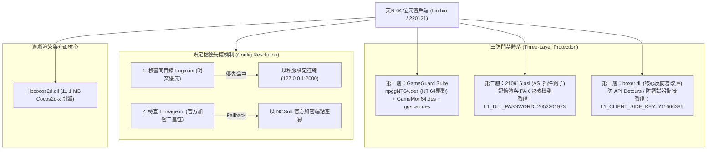

# 🌐 天R客戶端門禁三防體系與 Connector API 實裝白皮書

> [!IMPORTANT]
> **專案價值與實證來源**：
> 本白皮書由 `WantedGaming/L1JR-RemasterConnector` 之實地網路監控日誌（`launcher_analysis_report.md`）與架構實裝手冊（`launcher_impl_guide.md`）深度提取而成。
> 全景揭秘天R官方 64 位元客戶端 `Lin.bin` 內建的**三層反外掛保護網**（GameGuard 核心驅動、`210916.asi` 記憶體鉤子、`boxer.dll` 反調試防篡改），以及天R私服登入器與伺服器通訊的 **Connector REST API 傳參協定**（解決了「參數必須以 QueryString 傳遞而非 JSON Body」的致命地雷）與 **HWID 四碼 WMI 採集標準**。

---

## 🗺️ 天R客戶端三防保護與啟動架構



---

## 🛡️ 一、天R客戶端「三防門禁」體系深度剖析

天R客戶端在 `bin64\` 目錄下具備三層防禦，私服自製登入器必須正確部署動態庫與設置環境變數，否則遊戲會遭到門禁攔截或靜默閃退：

### 1.1 第一層：GameGuard 系統級保護套件
位於 `bin64\GameGuard\` 目錄，為 NCSoft 原廠配置之系統級防護：
- **`npggNT64.des`** (1.88 MB)：64 位元 NT 核心層驅動，提供內核層進程保護。
- **`GameMon64.des`** (9.11 MB)：64 位元使用者態主監控模組。
- **`ggscan.des`** (2.38 MB) & **`ggsig.des`** (30 KB)：外掛特徵碼掃描器與特徵資料庫。
- **`npgg.erl` / `npgl.erl`**：版本化規則加密檔。

### 1.2 第二層：`210916.asi`（客戶端 ASI 插件鉤子）
- **檔案規格**：約 137.5 KB（140,800 位元組），屬 Rockstar ASI 格式外掛模組。
- **核心職責**：
  1. 記憶體行為監控：掃描遊戲內存是否發生加速（Speed Hack）、穿人穿牆（No-clip）或透視（ESP）。
  2. 資源完整性校驗：監控 `data.pak`、`ui.pak` 等容器檔案是否遭到竄改。
  3. 違規上報：一旦抓獲異常，向伺服端發送特定違規通知以執行封鎖。
- **鑑權門禁**：透過啟動時的進程環境變數 **`L1_DLL_PASSWORD=2052201973`** 進行身分驗證。

### 1.3 第三層：`boxer.dll`（核心反篡改與防調試庫）
- **檔案規格**：約 1.02 MB（1,073,848 位元組）。
- **核心職責**：
  1. 反調試（Anti-Debugging）：主動偵測 x64dbg、Cheat Engine、IDA Pro、OllyDbg 等調試器掛接。
  2. 防鉤子（Anti-Hooking / Detours）：阻止外部進程對客戶端關鍵函數（如 `WSASend`、`WSAConnect`、DirectX 渲染函數）掛設 API Detour。
  3. 代碼段自校驗：定時校驗 `.text` 代碼段雜湊，防止內存補丁（Memory Patch）。
- **鑑權門禁**：透過啟動時的進程環境變數 **`L1_CLIENT_SIDE_KEY=711666385`** 進行解鎖。

---

## 📄 二、設定檔優先權：`Login.ini` 取代 `Lineage.ini`

天R客戶端在啟動時有嚴格的設定檔尋找邏輯：

1. **`Lineage.ini`（原廠二進位加密檔）**：
   - 官方 NCSoft 啟動器使用。
   - 內含全加密的官方伺服器清單與認證伺服器 URL，非明文可讀。
2. **`Login.ini`（私服明文覆蓋機制）**：
   - **重大發現**：`Lin.bin` 啟動時會**優先檢查目錄下是否存在 `Login.ini`**！
   - 若偵測到 `Login.ini`，客戶端會自動跳過官方 `Lineage.ini` 的解密流程，直接以 `Login.ini` 中指定的 IP 與 Port 建立連線。
   - **標準私服內容**：
     ```ini
     [Server]
     ip=127.0.0.1
     port=2000

     [Options]
     RememberUser=1
     Language=1
     ```

---

## 🔌 三、Connector REST API 傳參協定與避坑指南

天R WebServer（Netty，Port 80）實作的 API 有嚴格的協議格式，過去私服開發者常因傳參方式錯誤卡在 400/500：

### 3.1 致命地雷：參數必須以 URL QueryString 傳遞！
天R伺服端的 `HttpLoginSession.java` 與 `HttpAccountManager.java` 採用標準 GET/QueryString 解析器。**即使發起的是 HTTP POST 請求，參數也必須拼裝在 URL 後面，不能放在 JSON 請求體（Body）中**！

### 3.2 完整端點清單與通訊規格

#### 1. 取得伺服器動態配置：`GET /outgame/info` 或 `/api/connector/info`
- **回傳**：Base64 加密 JSON。
- **解密算法**：以 `CONNECTOR_ENCRYPT_KEY`（`mOIjQ7ffyEV6w1SodWVqfwoU7qJCxzIhsqw6IM30okU=`）進行循環異或：
  ```csharp
  public static string Decrypt(string base64Str, string keyStr) {
      byte[] data = Convert.FromBase64String(base64Str);
      byte[] key = Convert.FromBase64String(keyStr);
      for (int i = 0; i < data.Length; i++) {
          data[i] ^= key[i % key.Length];
      }
      return Encoding.UTF8.GetString(data);
  }
  ```

#### 2. 登入鑑權：`POST /outgame/login?<QueryString>`
- **請求範例**：
  ```http
  POST /outgame/login?account=player1&password=pass123&mac_address=A1B2C3...&hdd_id=D4E5F6...&board_id=B1...&nic_id=N1...&process=explorer.exe,chrome.exe&mac_info=real_mac HTTP/1.1
  Host: 127.0.0.1
  Content-Length: 0
  ```
- **成功回傳**：
  ```json
  {
    "result_code": "SUCCESS",
    "auth_token": "cGxheWVyMS4xNzI5Nzg5MjE="
  }
  ```

#### 3. 快速註冊：`POST /outgame/accountcreate?<QueryString>`
- **請求參數**：`account`, `password`, `phone`, `mac_address`, `hdd_id`, `board_id`, `nic_id`, `mac_info`。
- **回傳**：`{"result_code": "SUCCESS"}` 或錯誤代碼（`FAIL_EXISTS_ACCOUNT` 等）。

---

## 💻 四、硬體 4 碼 HWID 採集標準（WMI 實裝）

為配合天R伺服端防多開（IP 5 開 / 硬碟 5 開）與帳號綁定，登入器需採用以下 WMI 查詢採集標準指紋，並統一以 SHA-256 輸出：

```csharp
[SupportedOSPlatform("windows")]
public class HardwareIdCollector
{
    // 1. MAC 位址 (過濾 Loopback，取首個實體網卡)
    public string GetMacAddress() {
        var nic = NetworkInterface.GetAllNetworkInterfaces()
            .FirstOrDefault(n => n.OperationalStatus == OperationalStatus.Up 
                && n.NetworkInterfaceType != NetworkInterfaceType.Loopback);
        return Hash(nic?.GetPhysicalAddress().ToString() ?? "00:00:00:00:00:00");
    }

    // 2. 硬碟唯一序號 (Win32_DiskDrive)
    public string GetHardDriveId() {
        using var s = new ManagementObjectSearcher("SELECT SerialNumber FROM Win32_DiskDrive");
        foreach (ManagementObject d in s.Get()) {
            var sn = d["SerialNumber"]?.ToString();
            if (!string.IsNullOrWhiteSpace(sn)) return Hash(sn.Trim());
        }
        return Hash("UNKNOWN_HDD");
    }

    // 3. 主機板序號 (Win32_BaseBoard)
    public string GetMotherboardId() {
        using var s = new ManagementObjectSearcher("SELECT SerialNumber FROM Win32_BaseBoard");
        foreach (ManagementObject b in s.Get()) {
            var sn = b["SerialNumber"]?.ToString();
            if (!string.IsNullOrWhiteSpace(sn)) return Hash(sn.Trim());
        }
        return Hash("UNKNOWN_BOARD");
    }

    // 4. 網卡晶片唯一碼 (Win32_NetworkAdapterConfiguration)
    public string GetNetworkInterfaceId() {
        using var s = new ManagementObjectSearcher("SELECT SettingID FROM Win32_NetworkAdapterConfiguration WHERE IPEnabled = True");
        foreach (ManagementObject n in s.Get()) {
            var id = n["SettingID"]?.ToString();
            if (!string.IsNullOrWhiteSpace(id)) return Hash(id.Trim());
        }
        return Hash("UNKNOWN_NIC");
    }

    private static string Hash(string text) {
        using var sha = SHA256.Create();
        return Convert.ToHexString(sha.ComputeHash(Encoding.UTF8.GetBytes(text))).ToLower();
    }
}
```

---

## 🎯 五、對我們專案的實質落地方案

1. **自研 RHDLauncher 實作無障礙切換**：
   - 既可走 **Direct Client 模式**（只需產生 `Login.ini` + 設置環境變數 `L1_DLL_PASSWORD` 與 `L1_CLIENT_SIDE_KEY` 即可直入遊戲）。
   - 亦可走 **Connector 模式**（呼叫 `/outgame/login` 取得 Token 後經 `A_NpLogin` 登入），實現 Web AppCenter 單點登入。
2. **解決天R API 400 錯誤**：
   - 明確了 POST 請求必須使用 QueryString 傳參的伺服端特性，避免在前端/登入器浪費除錯時間。
3. **安全審查核對**：
   - 確保自製 Hook DLL（如我們研究的 `SocketMain` 重定向）在啟動時不會被 `boxer.dll` 視為惡意 Detour 而遭到攔截。

---

## 🔗 關聯知識庫筆記導航
- [[20261024-天R雙通道認證協定與Connector伺服端網路架構全景手冊]] —— 雙通道通訊時序與 A_NpLogin 封包解析
- [[20261024-天R開源Connector技術深度解析-啟動注入管線與PAK雙層加密破譯]] —— Lin.bin 啟動注入與 PAK 雙層加密
- [[20261024-天R-自製登入器RHDLauncher企畫書]] —— 自研 Rust 登入器規格書
- [[20261024-天R客戶端BIN反編譯與主體脫殼]] —— Lin.bin 脫殼、Protobuf Schema 全量還原
