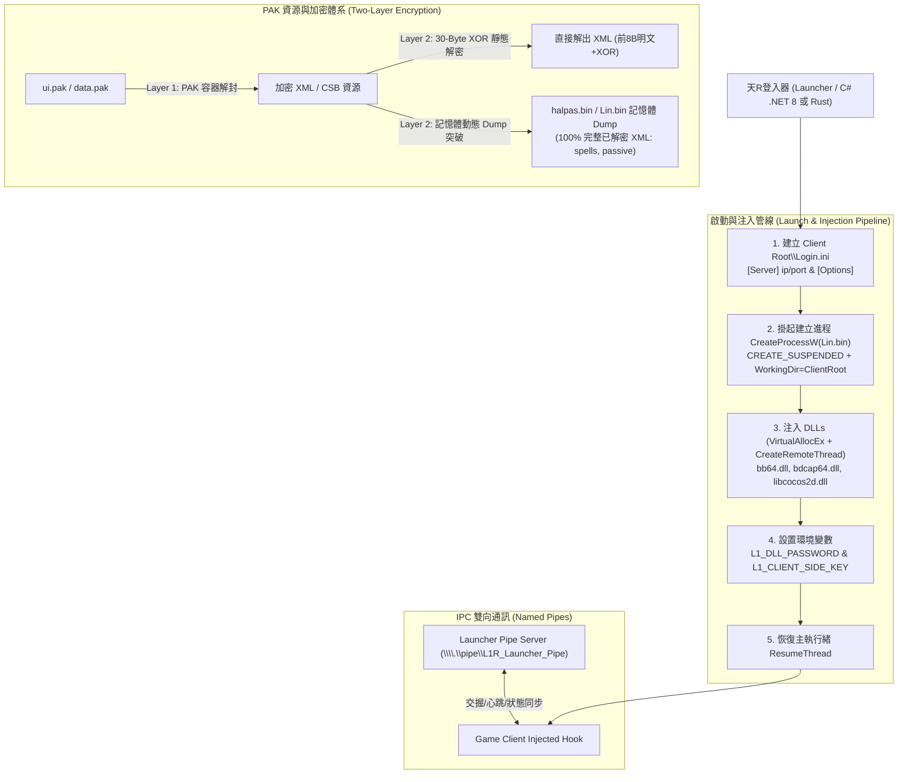

# 🌐 天R開源 Connector 技術深度解析：Lin.bin 啟動注入管線、雙層 PAK 加密破譯與記憶體取證實戰

> [!IMPORTANT]
> **知識定位與調研來源**：
> 本文深入剖析 GitHub 開源倉庫 `WantedGaming/L1JR-RemasterConnector` 與 `iamtieqi/L1JR-RemasterConnector` 之核心架構，結合韓國 TodayNC 及歐美 L1Justice 之天R（Lineage Remastered / L1R）私服研究資產。
> 本篇針對天R官方 64 位元客戶端 `Lin.bin`（或 `halpas.bin`）的**掛起注入啟動管線**、**環境變數與 Login.ini 傳參**、**PAK 雙層加密破解（30-Byte / 38-Byte XOR Key）**以及**執行期記憶體 Dump 取證突破**進行完整還原，為自研 [[20261024-天R-自製登入器RHDLauncher企畫書|RHDLauncher]] 與資源解密提供權威工程指南。

---

## 🗺️ 天R Connector 與客戶端互動拓撲



---

## 🚀 一、Lin.bin / halpas.bin 啟動與環境初始化管線

在 `WantedGaming/L1JR-RemasterConnector` 的 `LinBinLauncher.cs` 與 `ProcessLaunchOrchestrator.cs` 中，揭露了天R客戶端啟動的關鍵工程細節：

### 1.1 工作目錄致命陷阱（Working Directory Rule）
- **關鍵規則**：啟動 `Lin.bin`（位於 `bin64\` 或 `bin32\`）時，`CreateProcess` 的 **`lpCurrentDirectory` 必須設置為客戶端根目錄（Client Root）**，絕對不能設為 `bin64\`！
- **崩潰根因**：客戶端內部的資源載入器（PAK/IDX、音效、UI 腳本）皆以相對路徑 `data\`、`ui\`、`skin\` 進行尋址。若工作目錄設為 `bin64\`，客戶端在初始化階段因找不到資源直接拋出記憶體訪問違例（0xC0000005）閃退。

### 1.2 `Login.ini` 規格與放置規則
天R客戶端（或其注入模組）在啟動時會讀取客戶端根目錄下的 `Login.ini` 獲取伺服器連線資訊：

```ini
[Server]
ip=127.0.0.1
port=2000

[Options]
RememberUser=1
Language=1
```
- `ip` / `port`：指定遊戲伺服器連線目標位址與端口。
- `Language`：語系代碼（`1` 通常代表韓文/繁中相容模式）。

### 1.3 掛起啟動與 DLL 注入管線（Suspended Injection）
天R客戶端具有自我完整性校驗與反調試機制，直接注入極易觸發攔截。標準啟動流程如下：

1. **掛起建立進程**：
   ```csharp
   // 使用 CREATE_SUSPENDED (0x00000004) 標誌建立進程
   NativeMethods.CreateProcess(
       clientPath,          // Lin.bin 路徑
       commandLine,         // 啟動命令列 (可為 null)
       IntPtr.Zero, IntPtr.Zero, false,
       ProcessCreationFlags.CREATE_SUSPENDED,
       environmentPtr,
       clientRootDirectory, // 必須為客戶端根目錄！
       ref startupInfo,
       out processInformation);
   ```
2. **DLL 順序注入**：
   在進程恢復前，透過 `VirtualAllocEx` 在目標進程分配空間寫入 DLL 全路徑，並以 `CreateRemoteThread` 調用 `kernel32!LoadLibraryW` 依序注入關鍵動態庫：
   - `bb64.dll`（核心通訊與協議攔截）
   - `bdcap64.dll`（圖形捕獲與渲染支援）
   - `libcocos2d.dll`（Cocos2d-x UI 引擎支援）
   - 備選舊代次組件：`210916.asi`、`boxer.dll`
3. **注入環境變數透傳**：
   透過進程環境塊注入安全密鑰：
   - `L1_DLL_PASSWORD`：登入器與 DLL 通訊授權密碼。
   - `L1_CLIENT_SIDE_KEY`：客戶端通訊校驗 Key。
4. **恢復執行緒**：
   調用 `ResumeThread(processInformation.hThread)` 正式進入遊戲主迴圈。

### 1.4 具名管道 (Named Pipe) IPC 架構
登入器建立服務端具名管道 `\\.\pipe\L1R_Launcher_Pipe`：
- **心跳檢測**：每 3 秒發送 ping，超時 10 秒判定客戶端異常退出。
- **帳號狀態同步**：將登入器通過 Web/OAuth 獲取的 Token 傳遞給遊戲內部的 Web AppCenter。

---

## 🔐 二、天R 客戶端 PAK 雙層加密體系破譯

在解包天R客戶端資源時，社群曾長期受困於「解出來的 XML/CSB 全是亂碼」。`WantedGaming` 的逆向成果揭露了其**雙層加密架構**：

```
[官方 PAK 壓縮包] 
       │
       ▼ (Layer 1: PAK 容器解密，如 PackViewer / PakEditor 處理)
[解壓後的原始檔案] ── 仍有亂碼！
       │
       ▼ (Layer 2: 檔案級 XOR 加密)
[真實可讀之 XML / CSB 資源]
```

### 2.1 30-Byte 重複 XOR 金鑰（XML 檔案）
針對 `ui.pak` 中的 XML 檔案（如 `2k_ChatUI.xml`、`ItemShopUI-c.xml`），逆向分析發現其採用**首 8 位元組明文，後續位元組以 30 位元組 XOR 金鑰循環異或**的規則：

- **首 8 位元組保持明文**：固定為 `<?xml ve`（十六進位 `3C 3F 78 6D 6C 20 76 65`）。
- **30-Byte 重複 XOR 金鑰十六進位**：
  ```
  bc 99 d6 ba c9 7d 88 a1 7e 16 c1 96 ec d5 39 e8
  07 b5 4d d6 78 fc fe 31 8d 4b d2 9f 44 ef
  ```

#### Python 解密與加密實作算法
```python
XOR_KEY_30 = bytes([
    0xbc, 0x99, 0xd6, 0xba, 0xc9, 0x7d, 0x88, 0xa1,
    0x7e, 0x16, 0xc1, 0x96, 0xec, 0xd5, 0x39, 0xe8,
    0x07, 0xb5, 0x4d, 0xd6, 0x78, 0xfc, 0xfe, 0x31,
    0x8d, 0x4b, 0xd2, 0x9f, 0x44, 0xef
])

def decrypt_xml(encrypted_data: bytes) -> bytes:
    """解密天R XML 檔案"""
    if len(encrypted_data) < 8:
        return encrypted_data

    # 前 8 位元組保持明文
    decrypted = bytearray(encrypted_data[:8])

    # 第 8 位元組起循環異或
    for i in range(8, len(encrypted_data)):
        key_index = (i - 8) % len(XOR_KEY_30)
        decrypted.append(encrypted_data[i] ^ XOR_KEY_30[key_index])

    return bytes(decrypted)
```

### 2.2 38-Byte 已知片段（主程式靜態特徵金鑰）
在主程式 `Lin.bin` 二進位中，`WantedGaming` 透過特徵搜尋定位到以下 38 位元組的 XOR 金鑰硬編碼片段（用於特定 UI 表格）：

```
74 0C 79 66 62 03 71 66 71 72 60 62 6C 03 19 16 14 17
03 66 6C 64 62 65 60 6C 68 03 19 56 53 45 16 3C 03 14 17 19
```
可利用腳本 `find_xor_key_in_exe.py` 在未知版本客戶端二進位中搜尋此片段，快速提取該版本擴展的 64/128/256 位元組完整金鑰。

### 2.3 Cocos2d-x `.csb` 二進位 UI 檔案免解密字串提取
天R大量使用 Cocos2d-x 預編譯二進位 UI（`.csb`）。若 XOR 金鑰不匹配，可直接利用 `csb_text_extractor.py` 掃描二進位中的 UTF-8 區段（`U+AC00`~`U+D7A3`）與 ASCII 區段，免解密直接抽取出介面上的韓文字串，作為多語系本地化翻譯依據。

---

## 🧠 三、記憶體動態取證突破法（Runtime Memory Extraction）

### 3.1 靜態破譯的極限
分析發現，天R部分高版本 `ui.pak` 中，不同 XML 的 XOR 金鑰並非單一常數，而是根據檔案名 Hash 或查表動態派生（共有超過 11 種變體）。在此情況下，靜態窮舉 XOR 金鑰成本極高。

### 3.2 突破方案：目標進程記憶體 Dump
**重大發現**：無論磁碟上的 PAK 如何雙層加密，**遊戲客戶端在運行時必須將 XML 解密為純文字存於記憶體堆疊中**！

| 維度 | 錯誤進程（Dump 失敗） | 正確進程（Dump 成功） |
| :--- | :--- | :--- |
| **目標進程** | `Login.exe`、`LEProc.exe`、`ProcLocal.exe` | **`halpas.bin`** 或 **`Lin.bin`**（遊戲主核心進程） |
| **失敗/成功原因** | 僅為外部外殼或更新器，不載入遊戲實際資料 | 真正的 64 位元遊戲主體，持有所有解密後的 UI/技能 DOM 樹 |
| **記憶體特徵** | 無 XML 標頭 | 含有大量 `<?xml version=` 明文字串 |

### 3.3 記憶體提取成果與位址分佈
在一個約 2.1 GB 的 `halpas.bin.dmp` 記憶體轉儲中，成功直接截獲 14 個完全解密的關鍵遊戲資料 XML：

| 記憶體偏移量 | 檔案大小 | 對應檔案名稱 | 內容描述 |
| :--- | :--- | :--- | :--- |
| `0x43f7d0ac` | 3,402 Bytes | `spells.xml` | 基礎魔法與法術資料庫 |
| `0x1209ccb4` | 4,406 Bytes | `AttachedEffectList.xml` | 技能與法術視覺特效綁定對照表 |
| `0x43fa10cc` | 37,502 Bytes | `PassiveSpells.xml` | 被動技能、被動觸發機率與數值（完整大檔） |

**取證結論**：遇到未解之 PAK 加密時，**「進遊戲 ➔ Dump halpas.bin 記憶體 ➔ 正則搜尋 `<?xml` 提取」**是 100% 能拿到乾淨明文的最強反制手段！

---

## 🎯 四、對本專案的具體指導與落地清單

| 專案模組 | 現狀缺口 | 借鑑 `L1JR-RemasterConnector` 的解決方案 |
| :--- | :--- | :--- |
| **自研 RHDLauncher (Rust)** | 需實作客戶端連線轉向與啟動門禁 | 1. 啟動 `Lin.bin` 時將工作目錄嚴格指向客戶端根目錄。<br/>2. 採用 `CREATE_SUSPENDED` + 注入 `bb64.dll`、`bdcap64.dll` 與 `libcocos2d.dll` 骨架。<br/>3. 在根目錄同步寫入 `Login.ini`。 |
| **天R資源提取工具** | 傳統吞檔器解出天R XML 呈現亂碼 | 整合 **30-Byte XOR 解密算法**（首 8 位元組保留 `<?xml ve`，後續循環異或），直接補完本機 `lineage-tool.ps1`。 |
| **UI 多語系繁體化** | 韓文 `.csb` 介面字串難以定位 | 引入 `csb_text_extractor.py` 的 UTF-8 區段直接掃描法，快速定位未翻譯之韓文 UI 文本。 |
| **高版本未知 PAK 加密** | 遇到無法靜態逆向的新資源封包 | 啟用 **Phase 2 記憶體 Dump 取證 SOP**：以管理員權限轉儲 `Lin.bin` 記憶體，直接提取明文 DOM 樹。 |

---

## 🔗 關聯知識庫筆記導航
- [[20261024-天R與L1J開源生態調研與L1J-Wanted同類倉庫深度比對報告]] —— 天R與 L1J 開源宏觀生態矩陣
- [[20261024-GitHub-L1J最新開源專案與實用工具生態收錄]] —— 2026 GitHub 全網 L1J 最新活躍倉庫收錄
- [[20261024-天R-自製登入器RHDLauncher企畫書]] —— Rust 登入器規格書與實作清單
- [[20261024-天R客戶端BIN反編譯與主體脫殼]] —— Lin.bin 脫殼、Protobuf Schema 全量還原與分派表逆向
- [[資源解密與吃檔操作指南]] —— 客戶端 PAK/IDX、XML 與 TBL 解析工具鏈手冊
