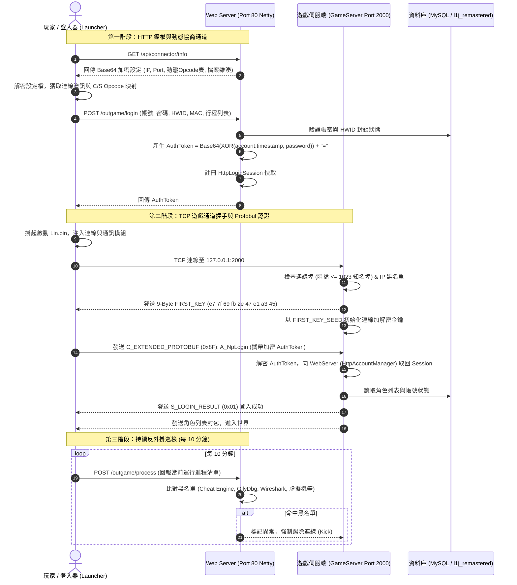

# 🌐 天R雙通道認證協定與 Connector 伺服端網路架構全景手冊

> [!IMPORTANT]
> **架構核心背景**：
> 傳統 L1J 私服多採用「客戶端直接向 GameServer (2000 Port) 發送明文/簡易 XOR 帳號密碼（如 `C_AuthLogin`）」的單軌架構。
> 而天R（Lineage Remastered）體系（以 `L1JR-Server`、`WantedGaming` 為代表）徹底革新為**「Web HTTP 鑑權 (Port 80) + 遊戲 TCP 封包 (Port 2000)」雙通道認證機制**，並引入了**動態 Opcode 下發協商**、**9-Byte `FIRST_KEY` 握手**、**`A_NpLogin` Protobuf 令牌驗證**與**排程行程黑名單監控**。
> 本手冊為開發天R伺服端協定解析器、補完自研登入器與客戶端資產轉譯提供完整技術實證。

---

## 🗺️ 天R雙通道認證與通訊時序全景圖



---

## ⚡ 一、第一階段：Web Server HTTP 動態協商與鑑權

### 1.1 `/api/connector/info` 動態 Opcode 與配置協商
傳統私服客戶端與伺服端的 Opcode 必須硬編碼對齊，一旦伺服器換代版本即崩潰。天R登入器透過 `/api/connector/info` 實現**動態協商**：
- **傳輸加密**：回傳之 JSON 內容均使用 `CONNECTOR_ENCRYPT_KEY`（如 `mOIjQ7ffyEV6w1SodWVqfwoU7qJCxzIhsqw6IM30okU=`）進行 Base64/AES 加密。
- **動態下發之關鍵欄位**：
  ```json
  {
    "serverIp": "<encrypted_base64>",
    "serverPort": "<encrypted_base64>",
    "linbin": "<encrypted_base64>",
    "linbinSize": "17020256",
    "linbinVersion": "2303281701",
    "clientSideKey": "711666385",
    "dllPassword": "2052201973",
    "C_CHANNEL": "0x37",
    "C_LOGIN": "0x55",
    "C_LOGOUT": "0x99",
    "S_KEY": "0x00",
    "S_EXTENDED_PROTO_BUF": "0x92",
    "C_EXTENDED_PROTO_BUF": "0x8F"
  }
  ```
登入器接收後在記憶體解密，並將 `C_EXTENDED_PROTO_BUF`（0x8F）與伺服器當前版本對齊，徹底解決 Opcode 跨版本漂移問題。

### 1.2 `/outgame/login` 憑證校驗與 `AuthToken` 生成
在登入器介面輸入帳號密碼後，發送至 Web 端而非 GameServer：
- **必填硬體指紋**：
  - `macAddress`：網路卡 MAC 位址雜湊
  - `hddId`：硬碟序號
  - `boardId`：主機板序號
  - `nicId`：網卡晶片唯一碼
  - `process`：啟動時之進程快照
- **AuthToken 生成算法（Java 伺服端標準）**：
  ```java
  public void makeAuthToken() {
      // 1. 組合明文：帳號.時間戳
      byte[] encoded = String.format("%s.%d", this.account, System.currentTimeMillis())
          .getBytes(StandardCharsets.UTF_8);
      // 2. 以密碼作為金鑰進行異或
      byte[] passwordBytes = this.password.getBytes(StandardCharsets.UTF_8);
      CommonUtil.encode_xor(encoded, passwordBytes, 0, encoded.length);
      // 3. 轉為 Base64 並尾綴 "="
      this.authToken = String.format("%s=", Base64.getEncoder().encodeToString(encoded));
  }
  ```
生成之 `HttpLoginSession` 保存在伺服端記憶體中，等待遊戲通道前來核驗。

---

## 🔒 二、第二階段：GameServer TCP 連線與 `A_NpLogin` 封包解析

### 2.1 9-Byte `FIRST_KEY` 握手
客戶端 TCP 握手連入 2000 Port 後，伺服器主動發出的首包並非天R的 `S_KEY`，而是專屬的 9 位元組連線種子：
- **二進位十六進位**：
  ```
  e7 7f 69 fb 2e 47 e1 a3 45
  ```
- **核心處理邏輯**：
  ```java
  _connection.send(Config.VERSION.FIRST_KEY);
  _cryption.initKeys(Config.VERSION.FIRST_KEY_SEED);
  _connection.resumeRecv();
  ```
客戶端接獲此包後，初始化封包 RC4/Blowfish 對稱金鑰管道。

### 2.2 `A_NpLogin` 封包二進位結構（Opcode 0x8F）
客戶端在握手後，將 Web 端取得之 `authToken` 封裝進 `C_EXTENDED_PROTOBUF`（Opcode 0x8F）的 `A_NpLogin` 封包中上傳：

```
[標頭 Header]
  byte    Opcode           = 0x8F (C_EXTENDED_PROTOBUF)
  short   TotalLength      = 整個封包長度

[Protobuf 欄位 Body]
  tag 1   0x08             = 0x08 (WireType 0: Varint)
          readBit()        = IP 數值
  tag 2   0x10             = 0x10 (WireType 0: Varint)
          readBit()        = OTP 驗證碼
  tag 3   0x1A             = 0x1A (WireType 2: Length-delimited)
          sublength        = 1 位元組長度
          auth_np_bytes    = NP 認證字串
  tag 4   0x22             = 0x22 (WireType 2: Length-delimited)
          auth_length      = Varint 長度
          encrypted_token  = 以 CONNECTOR_ENCRYPT_KEY 加密之 Base64 AuthToken
  tag 5   0x2A             = 0x2A (WireType 2: Length-delimited)
          maclength        = 1 位元組長度
          mac_hash         = MAC 雜湊值
```

### 2.3 伺服端鑑權驗證邏輯
```java
// 解密 AuthToken
String authToken = Base64.decryptToKey(
    new String(auth_bytes, CharsetUtil.UTF_8),
    Config.LAUNCHER.CONNECTOR_ENCRYPT_KEY
);

// 從 WebServer 記憶體快取中提取 Session
HttpLoginSession session = HttpAccountManager.get(authToken);
if (session == null) {
    _client.sendPacket(S_CommonNews.SESSOION_EMPTY);
    return;
}

// 帳號合法性校驗與防多開檢查
Authorization.getInstance().auth(_client,
    session.getAccount(),
    session.getPassword(),
    _client.getIp(),
    _client.getHostname()
);
```
若金鑰不吻合或來自未授權登入器，伺服端回送 `S_CommonNews.OTHER_CONNECTOR` 並排程 1,500ms 後強制斷線，有效杜絕直接裸連。

---

## 🛡️ 三、伺服端安全、多開管制與反外掛巡檢

### 3.1 知名埠與防護門禁
`LoginServer.java` 內建防禦底線：
- **埠門禁**：連線來源 Port `<= 1023`（`WELLKNOWN_PORT`）一律強制關閉並寫入黑名單，防止透過本機特權埠發起反射攻擊。
- **多開限制**（`server.properties`）：
  - `ALLOW_2PC = true`
  - `ALLOW_2PC_IP_COUNT = 5`（同 IP 最多 5 開）
  - `ALLOW_2PC_HDD_COUNT = 5`（同硬碟最多 5 開）

### 3.2 第三階段：進程黑名單巡檢（10 分鐘週期）
天R登入器必須在背景定時（每 10 分鐘）向 `/outgame/process` 提交客戶端行程清單，伺服器對比 `CONNECTOR_ENGINE_NAMES` 黑名單：
```
cheet engine, decoder, hack, revolution, linmaster, linfree, linpago, 
nalyitqs, flba, wireshark, virtualbox, mixmaster, parallels, qemu, hyper-v
```
若偵測到記憶體掃描器（Cheat Engine）、封包擷取（Wireshark）或虛擬機（QEMU/VirtualBox），伺服器將直接下發封包斷開遊戲連線。

---

## 📦 四、客戶端資產結構演進：從舊版 HTML 到天R UML

在調研日本天R客戶端本地化專案 `AlovieSoftware/LineageRemaster_JP2EN` 時，確認了天R在客戶端資產體系上的重大架構更替：

### 4.1 對話系統更替：`.html` ➔ `.uml`
- 傳統 3.81/8.50 客戶端對話全部存於 `Text.pak` 之 `.html`（如 `teleport-c.html`）。
- **天R全面改用 `.uml` 格式**（如 `veil_raid-j.uml`、`valen_craft-j.uml`、`wcd_story-j.uml`），具備更嚴格的標籤閉合要求與嵌入式變數支援。

### 4.2 物品與描述表格體系
天R客戶端 `data\` 目錄核心定義表結構：
- `ItemDesc-j.tbl`：物品基礎數值與描述。
- `QuestDesc-j.tbl`：任務步驟與對話關聯。
- `SpellExDesc-j.tbl`：新世代被動技能、九職業擴展技能文字說明。
- `desc-j.tbl`：直擊無名稱與問號的核心 `$ID` 字符串池。
- `string-j.tbl`：系統彈窗與 UI 提示文字。

### 4.3 武器分類與 `iconId` 雙軌映射表
在天R資料庫 `l1j_remastered` 中，物品圖示不再依賴 `item_id`，而是全面引入 `iconId`：
- **`item_id`**：資料庫主鍵（唯一物品 ID）。
- **`iconId`**：指向 `icon.pak` 內的圖素編號（如 `245.png`、`1823.png`），不同強化階段與同源武器共享同一 `iconId`。
- **16 大武器列舉類別（全大寫）**：
  ```
  SWORD, BOW, STAFF, TOHAND_SWORD, DAGGER, BLUNT, EDORYU, SPEAR,
  CLAW, SINGLE_SPEAR, KEYRINGK, CHAINSWORD, TOHAND_BLUNT,
  SINGLE_BOW, TOHAND_STAFF, GAUNTLET
  ```

---

## 🎯 五、對我們專案的指導價值與後續落地方案

1. **自研 RHDLauncher 認證鏈落地**：
   - 補完登入器第一步：發起 HTTP `GET /api/connector/info` 取得動態 Opcode，不再將 Opcode 寫死在 Rust/C# 二進位中。
   - 封裝 `A_NpLogin` 封包構造器，將 Web 鑑權成功之 Token 以 Protobuf Tag 4 (`0x22`) 正確回傳 GameServer。
2. **天R服務端 (L1RHD) 漏洞閉環**：
   - 借鑑其 `LoginServer.java` 的 Port `<= 1023` 防護與 `FIRST_KEY` 握手機制，排查我們 `gs.jar` 是否存在未登入繞過缺陷。
3. **客戶端資產本土化流水線**：
   - 針對天R問號與亂碼問題，直接借鑑 `LineageRemaster_JP2EN` 的 `.tbl` 轉譯流水線，將其 `copy_daemon.py` 與 `translate.py` 整合進我們自動化吃檔工具鏈中。

---

## 🔗 關聯知識庫筆記導航
- [[20261024-天R開源Connector技術深度解析-啟動注入管線與PAK雙層加密破譯]] —— Lin.bin 注入管線與 PAK 雙層加密
- [[20261024-天R客戶端端到端登入與選角封包序列實證手冊]] —— 端到端封包序列與二進位佈局
- [[20261024-天R客戶端BIN反編譯與主體脫殼]] —— Lin.bin 脫殼、Protobuf Schema 全量還原
- [[20261024-天R-自製登入器RHDLauncher企畫書]] —— 自研登入器規格與模組劃分
- [[天R-L1RHD核心安全與專屬漏洞深度審計報告]] —— 天R 50 項重大缺陷審計報告
